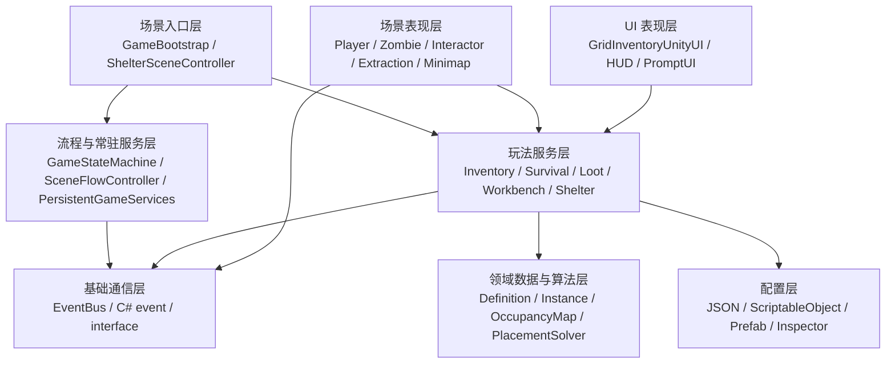

# 《余烬之下》Unity 面试项目手册

> 适用岗位：1～3 年 Unity 游戏客户端 / Unity 游戏开发工程师  
> 项目版本：Unity 2022.3.62f1  
> 使用原则：只讲自己真正理解并能根据代码继续展开的内容，不把策划文档或预留接口说成完整成品。

> 本文件保留“速查与题库”定位。需要逐题刨根问底时，请进入 [《余烬之下》Unity 面试深挖教材](./面试深挖/README.md)。

## 阅读与训练路线

这份手册不是逐字背诵稿，建议分四轮使用：

- 第一轮：阅读第一、二、五、六章，形成项目定位、简历表述和 2 分钟介绍。
- 第二轮：精读第三、四章，能不用文档画出模块依赖、生命周期和设计模式证据。
- 第三轮：练习第七章。每道题先用 30 秒回答，再接受连续三次“为什么”和“如果规模扩大怎么办”。
- 第四轮：按第十章查漏补缺，并用第十一章的顺序实际演示 Demo。

不同面试级别的重点：

| 目标 | 必须掌握 | 加分内容 |
|---|---|---|
| 校招/初级 | 生命周期、C#、背包数据结构、交互流程 | 回滚、JSON 配置、Profiler 基础 |
| 1～3 年 | 模块边界、跨场景生命周期、设计模式取舍、性能定位 | 测试、存档迁移、两阶段提交、asmdef |
| 中级以上 | 不变量、事务、并发/联网演进、资源生命周期、工程化 | 架构重构计划和真实测量数据 |

练习时禁止只回答模式名称。例如不要只说“这里用了观察者模式”，而要继续说明：谁发布、谁订阅、为何不直接调用、同步还是异步、如何解绑、静态生命周期有什么风险。

## 一、先给项目一个准确定位

《余烬之下》是一个 2D 末日生存搜打撤 Demo。玩家从庇护所出发进入探索地图，完成移动、战斗、搜索、物资管理和撤离，再把战利品带回庇护所。项目的重点不是美术完成度，而是用相对完整的数据和系统结构跑通一轮“基地 → 出击 → 搜索与战斗 → 撤离 → 返回基地”的玩法闭环。

当前项目确实已经实现的主要内容：

- 基地与局内两个场景，以及跨场景主循环。
- 常驻的背包、生存属性、状态机、掉落表和基地服务。
- 类《逃离塔科夫》的多格网格背包：占格、旋转、堆叠、拆分、合并、快速转移、整理和锁格。
- 世界物品、搜索容器和僵尸尸体共用的物资转移流程。
- 搜索交互的距离、楼层和隔墙视线验证。
- 容器首次生成、逐件揭示以及会话级状态恢复。
- JSON 驱动的物品、消耗效果和随机掉落表。
- 饥饿、口渴、疲劳、感染、生命值及其战斗联动。
- 近战、远程武器、投射物、动画事件、击退、Hitstop 和相机震动。
- 僵尸追击、近战攻击、死亡和尸体搜索。
- 多楼层显示、Y 轴排序和实时 RenderTexture 小地图。
- AssetBundle 本地/远端加载、依赖、Hash/CRC 校验的实验模块。

当前不能说成正式完成的内容：

- 没有正式的磁盘存档系统；搜索状态目前只是会话级内存快照。
- 工作台、夜袭、饮水台和休息区已有服务或交互入口，但不等于完整产品级玩法。
- AI 目前更接近轻量追击与近战状态控制，不是完整行为树、NavMesh 或复杂感知系统。
- 还没有系统化的 Unity Test Framework 自动化测试。
- AssetBundle 是独立技术验证，不是整个项目资源框架；不能说项目已全面完成热更新。
- 项目仍存在较大的 UI 控制器、较多 FindObjectOfType 和运行时 Instantiate/Destroy，尚未完成产品级重构和优化。

## 二、项目最值得讲的技能点

### 1. 多格网格背包与事务式物品操作

这是项目中最强的技能点，建议作为主讲内容。

实现拆分：

- `GridItemDefinition` 保存物品尺寸、是否可旋转、堆叠上限、标签、品质、重量和使用效果。
- `GridItemInstance` 保存实例 ID、数量、旋转、容器 ID 和左上角坐标。
- `GridContainerDefinition` 保存行列、锁格容量、标签限制和 Player/Storage/WorldLoot/Corpse 归属。
- `GridOccupancyMap` 用二维数组记录格子占用者和锁格状态。
- `GridPlacementSolver` 负责 footprint 计算和 First Fit 搜索。
- `GridInventoryService` 统一管理定义、实例、占用矩阵、容器成员关系和物品操作。
- UI 只发起拖放、旋转、转移等请求，最终合法性由 Service 判断。

可以强调的工程思维：

- 静态定义与动态实例分离。同一种罐头共享一份定义，但每一组堆叠拥有独立实例 ID 和位置。
- 数据状态与显示分离。格子能否放置不能由 RectTransform 重叠判断，而由占用矩阵决定。
- 跨容器移动先清理旧占用，尝试写入新占用；失败则恢复旧位置，避免物品丢失。
- 批量添加物品先合并已有堆叠，再创建新实例；任何一步失败都会恢复堆叠快照并删除本次新建实例，保证“全成功或全失败”。
- 自动整理先压缩同类堆叠，再按类型、面积和数量排序，最后用 First Fit 重新放置。
- Player、Storage、WorldLoot、Corpse 通过 OwnerType 区分，避免制作或消耗时误读基地仓库或世界容器。

算法复杂度可以这样说：

- 检查一个 `w × h` 物品能否放置的复杂度为 `O(w × h)`。
- First Fit 最坏会扫描 `R × C` 个起点，每个起点再检查物品面积，所以可近似写成 `O(R × C × w × h)`。
- 当前背包只有百级格子，朴素扫描简单、稳定且足够快；如果扩展到大型仓库，可以增加空闲矩形索引、位图或更强的装箱算法。
- 当前自动整理是启发式算法，不保证二维装箱的全局最优解。这一点主动承认反而显示你理解问题本质。

### 2. 搜索、掉落与状态恢复的统一闭环

系统从世界交互一直贯通到背包：

1. `PlayerInteractor2D` 从注册表中筛选当前楼层、可交互且在范围内的最近目标。
2. 距离按 Collider 的 `ClosestPoint` 计算，避免大型容器按中心点计算导致手感错误。
3. 使用 Linecast 检查玩家到交互点之间是否被当前楼层墙体阻挡。
4. 首次按住搜索完成后，`SearchableLootContainer` 从 JSON 掉落表抽取物资。
5. 容器注册成运行时网格，掉落通过背包服务进行真实放置。
6. 物品按格子顺序逐件揭示，搜索时间受品质影响。
7. 未揭示物品禁止转移、旋转、拆分和丢弃。
8. 容器状态按稳定 ID 保存是否生成、剩余布局和揭示状态，场景重载时恢复而不是重新抽取。

这里可以讲的设计价值：世界箱子、露天物资和尸体没有各写一套背包逻辑，而是复用同一个容器与物品实例模型。差异只体现在容器归属、掉落表、UI 和生命周期。

### 3. 跨场景服务与一局生命周期

项目没有让 Player、Camera 和 Canvas 全部常驻，而是区分：

- 数据服务跨场景：背包、生存属性、状态机、掉落数据库、基地服务。
- 表现对象属于场景：玩家、地图、相机、UI、出生点和撤离点。

`PersistentGameServices` 通过 `DontDestroyOnLoad` 保留第一套服务；另一场景也预摆同一核心 Prefab，方便任何场景独立启动，但加载后会销毁新场景带来的重复服务。`SceneFlowController` 管理基地和地图之间的异步切换，并在新一局开始时只清理 WorldLoot/Corpse 临时容器，保留 Player 和 Storage 数据。

这个设计的优点：

- 每个场景都能直接 Play，减少调试对入口场景的依赖。
- 数据生命周期与视觉对象生命周期清晰。
- 撤离物资能够保留，但旧地图的尸体和搜索容器不会污染下一局。

要主动说明的不足：目前仍依赖 Unity 对象和 `FindObjectOfType` 补引用，规模扩大后应使用明确的 Composition Root、依赖注入或场景加载完成后的绑定接口。

### 4. 数据驱动物品与掉落

项目把 156 个物品定义和 6 张掉落表放在 JSON 中，并提供 11 个可复用的消耗效果档案。多个物品可以映射到同一个 Profile，例如不同水果共享使用时间、标签和生存效果，物品自身的显式配置可以覆盖 Profile。

掉落表保存抽取次数、权重、数量范围，`LootTableDatabase` 负责加权随机并把结果发给统一背包入口。

可以谈的取舍：

- JSON 方便批量维护、外部工具生成和版本对比。
- ScriptableObject 更适合编辑器内强类型引用、资源拖拽和可视化配置。
- 当前项目武器使用 ScriptableObject，批量物品/掉落使用 JSON，是根据数据形态做的混合方案。
- `JsonUtility` 对字典、多态和版本迁移支持较弱；正式项目可增加 DTO、Schema Version 和配置校验工具，或采用 Newtonsoft.Json。

### 5. 生存属性与玩法系统联动

生存系统不是单纯显示四条进度条：

- 数值按“每分钟变化量 × deltaTime / 60”连续衰减，与帧率无关。
- 只有 Breakout、Raid 和可配置的 NightAssault 阶段推进，基地与结算默认暂停。
- 口渴过低降低移动速度，饥饿过低降低伤害，疲劳危险时禁止蓄力攻击。
- 极度饥饿、缺水和感染会叠加持续掉血。
- 消耗品使用前判断是否存在有效收益，防止满状态浪费。
- 完成后按选中实例 ID 精确扣除一件，避免扣错同类堆叠。

面试表达重点：属性系统输出的是 `MoveSpeedMultiplier`、`DamageMultiplier` 和 `CanUseChargeAttack` 等能力结果，角色控制器消费这些结果，而不是让生存系统直接操纵角色输入。

### 6. 2D 战斗的配置、判定与反馈

- 武器用 `WeaponDefinition : ScriptableObject` 配置近战/远程类型、姿势、伤害、冷却、范围、击退、投射物和命中层。
- 近战使用范围检测，远程生成 `Projectile2D`。
- 动画事件决定真正的攻击判定或发射时机，保证表现与逻辑对齐，同时保留 fallback，避免动画事件漏配导致永远不伤害。
- `IDamageable` 提供简单伤害兼容，`IHitReceiver + DamageInfo` 传递方向和击退等完整命中信息。
- 投射物忽略发射者碰撞，只命中指定 Layer，并再次验证楼层与敌对关系。
- 通过 Hitstop、相机震动、受击变色和击退增强打击反馈。

### 7. 多楼层 2D 渲染与交互一致性

项目同时处理逻辑楼层和视觉楼层：

- Actor_F0/F1/F2 和 Wall_F0/F1/F2 用于碰撞与命中过滤。
- Sorting Layer 与 Y 坐标排序解决角色前后遮挡。
- `FloorSortingState` 保存当前楼层、渲染覆盖和可见楼层。
- 室内外显隐、楼梯切换、投射物层、搜索交互和小地图都使用同一楼层信息。

重点不是“用了 Layer”，而是避免不同子系统各自猜楼层，导致二楼子弹打到一楼敌人、隔层容器可搜索或小地图标记错层。

### 8. 实时小地图

- 专用正交相机按 10 FPS 左右手动 `Camera.Render()` 到 RenderTexture。
- RawImage 显示真实场景结果，玩家和兴趣点使用独立 UI 标记。
- Follow Player 模式动态计算相机可见世界矩形，再把世界坐标归一化到 MarkerLayer 局部坐标。
- Whole Floor 模式使用配置的 worldMin/worldMax。
- 相机关闭 HDR、MSAA、遮挡剔除并配置 CullingMask，降低第二相机开销。

这里适合讲一次坐标映射：

`normalizedX = InverseLerp(worldMin.x, worldMax.x, worldX)`，再通过 `Lerp(rect.xMin, rect.xMax, normalizedX)` 转换为 UI 局部坐标；Y 轴同理。

### 9. 编辑器工具意识

项目提供了地图 Tile 深度拆分、背包布局、搜索容器 UI、人物 HUD、小地图和基地灰盒等 Editor 工具。面试时可以强调：对于大量重复配置，编辑器工具能减少手工拖引用和场景不一致；但运行时代码与 Editor 代码应该通过 `Assets/Scripts/Editor` 或程序集定义隔离。

当前不足是业务代码尚未建立自己的 asmdef，后续可以拆成 Core、Inventory、Gameplay、UI、Editor、Tests，降低全量重编译和模块耦合。

### 10. AssetBundle 技术验证

项目存在本地和远端 AssetBundle 加载实验：

- 本地使用 `AssetBundle.LoadFromFile`。
- 远端使用 `UnityWebRequestAssetBundle`。
- 读取根 Manifest 并加载依赖包。
- 支持 Hash 或 CRC 校验。
- 缓存已加载 Bundle，最后卸载。

安全回答：这是资源加载专项验证，说明自己理解 Bundle、Manifest、依赖和校验，但主项目目前仍使用 Resources 和直接 Prefab 引用，尚未完成 Addressables/AssetBundle 全面改造，也不把它包装成完整热更新系统。

## 三、项目框架与模块架构

### 3.1 先说结论：这是什么框架

这个项目不是使用某个现成的大型游戏框架，也不是严格的 ECS、MVC 或 MVVM。它当前更准确的描述是：

> 以 MonoBehaviour 作为 Unity 运行载体，以 Service 作为核心数据入口，以场景 Bootstrap 负责装配，以接口和事件完成部分解耦，以 JSON/ScriptableObject 驱动配置的轻量分层玩法框架。

面试时不要说“我自研了一套完整 Unity 框架”。更稳妥的说法是：

“我围绕这个项目搭了一套轻量玩法框架，重点解决服务生命周期、场景装配、数据与表现分离、模块通信和配置驱动。它还不是通用商业框架，但核心边界已经形成，并且我能说明下一步如何演进。”

### 3.2 整体分层



各层职责：

- 场景入口层：找到或创建场景所需对象，把常驻服务与场景对象重新绑定，决定玩家出生和流程开始。
- 流程与常驻服务层：决定当前玩法阶段、场景切换以及哪些数据跨场景生存。
- 玩法服务层：提供背包、掉落、生存、制作等用例入口，不应该让 UI 直接篡改数据。
- 场景表现层：读取输入、驱动物理与动画、执行世界交互和显示规则。
- UI 表现层：把服务状态转换成可视内容，并把用户意图转成 Service 请求。
- 领域数据与算法层：尽量不关心场景对象，表达物品、容器、占用和放置规则。
- 配置层：存放可调参数与资源引用。
- 通信层：为模块间的直接调用、接口调用和广播事件提供不同耦合度的选择。

### 3.3 模块依赖方向

项目的理想依赖方向是：

```text
UI / Player / World Object
        ↓ 发起请求、读取结果
Gameplay Service
        ↓ 调用纯数据和算法
Domain Model / Solver
        ↓ 读取
Configuration
```

例如背包拖放：

```text
PointerEventData
→ GridInventoryUnityUI 计算目标格
→ GridInventoryService.TryMove
→ GridPlacementSolver.CanPlace
→ GridOccupancyMap.IsAreaEmpty
→ 成功提交或失败恢复
→ UI 下一帧/刷新时读取最终状态
```

这个方向的核心原则是“表现层可以依赖数据服务，但数据规则不能反过来依赖某个具体按钮或 RectTransform”。

当前没有完全做到的地方：

- `GridInventoryService` 仍是 MonoBehaviour，纯领域逻辑与 Unity 生命周期没有彻底隔离。
- UI 类职责过多，既做 View，又做输入控制、布局和部分协调。
- 多个系统通过 `FindObjectOfType` 解析服务，依赖没有完全显式化。
- 静态 EventBus 和静态容器状态仓库使测试隔离更困难。

### 3.4 核心模块职责表

| 模块 | 核心类型 | 负责什么 | 不应该负责什么 |
|---|---|---|---|
| 流程 | GameStateMachine | 阶段状态和切换事件 | 场景加载细节、UI 动画 |
| 场景流转 | SceneFlowController | 基地/局内异步切换、新局标记 | 背包内部规则 |
| 生命周期 | PersistentGameServices | 常驻服务唯一性、重复核心清理 | 让所有场景对象常驻 |
| 局内装配 | GameBootstrap | 找服务、生成玩家、绑定局内系统 | 成为所有业务逻辑的 God Object |
| 基地装配 | ShelterSceneController | 基地玩家、仓库 UI 和交互绑定 | 永久保存角色 GameObject |
| 背包入口 | InventoryService | 给制作、奖励等系统提供简单库存 API | 保存第二份库存数据 |
| 背包领域服务 | GridInventoryService | 容器、实例、占用、转移、整理、回滚 | 直接依赖具体鼠标事件 |
| 放置算法 | GridPlacementSolver | footprint、CanPlace、First Fit | 生成 UI 或访问场景 |
| 搜索 | SearchableLootContainer | 首搜、逐件揭示、UI 开关和快照 | 自己实现一套库存 |
| 交互 | PlayerInteractor2D | 目标选择、按住、距离、楼层和视线 | 知道每种交互物内部逻辑 |
| 掉落 | LootTableDatabase | 配置加载、加权抽取和奖励入口 | 决定物品在 UI 的位置 |
| 生存 | SurvivalSystem | 属性流逝、阈值和能力修正 | 读取键盘输入或直接操纵 UI |
| 战斗 | PlayerCombatController2D | 输入、攻击状态、判定和动画协同 | 承担全局流程和存档 |
| 小地图 | MinimapRealtimeRenderer/Controller | 地图渲染、坐标映射与标记 | 修改真实楼层状态 |

### 3.5 启动与装配流程

以从基地正式启动为例：

1. Unity 加载 `ShelterScene`。
2. 场景预摆的 `PersistentGameCore` 执行 Awake。
3. `PersistentGameServices` 检查是否已有常驻实例。
4. 首次进入时把核心根对象移入 DontDestroyOnLoad 场景。
5. `ShelterSceneController.Start` 解析背包、生存和基地服务。
6. 注册或确认 `shelter_stash` Storage 容器。
7. 基地 UI 绑定同一 `GridInventoryService`。
8. 生成场景本地 Player，并绑定 PlayerInteractor。
9. 玩家与出击点交互后调用 `SceneFlowController.LoadRaid()`。
10. 新一局开始前清理搜索快照和临时 WorldLoot/Corpse 容器。
11. 异步加载 `StartScene`。
12. 新场景预摆的重复核心在 Awake 被销毁，旧核心继续保存数据。
13. `GameBootstrap` 生成局内玩家、定位出生点并重新绑定 UI/交互。
14. 状态机进入 Raid，生存属性开始推进。

面试官如果追问“为什么装配流程重要”，回答：

“Unity 项目最容易出现的不是单个算法错误，而是对象何时创建、谁拥有它、切场景后引用是否仍有效。把装配和业务分开后，业务服务不需要自己到处创建 UI 或玩家，生命周期更可控。”

### 3.6 一局数据生命周期

| 数据 | 基地到局内 | 局内回基地 | 新一局 | 退出进程 |
|---|---:|---:|---:|---:|
| 玩家背包 | 保留 | 保留 | 保留 | 当前不保留 |
| 基地仓库 | 保留 | 保留 | 保留 | 当前不保留 |
| 生存属性 | 保留 | 保留 | 保留 | 当前不保留 |
| 世界搜索容器 | 新建/恢复本局 | 内存快照可暂存 | 清理 | 丢失 |
| 僵尸尸体容器 | 本局创建 | 场景卸载 | 清理 | 丢失 |
| 玩家 GameObject | 场景重建 | 场景重建 | 场景重建 | 销毁 |
| UI/Camera | 场景重建 | 场景重建 | 场景重建 | 销毁 |

这张表体现了“数据生命周期”和“GameObject 生命周期”分开设计。

### 3.7 通信方式为什么不是只用一种

项目同时使用三种通信方式：

- 直接调用：调用者明确需要结果，例如 `TryMove`、`TryCraft`、`LoadRaid`。优点是调用链清楚、可返回成功失败。
- 接口调用：调用者只依赖能力，例如 `IWorldInteractable`、`IDamageable`、`IHitReceiver`。优点是可替换实现。
- 事件通知：一个事实可能被多个系统关注，例如阶段变化、撤离完成、夜袭结算。发布者不需要知道所有监听者。

选择规则：

- 需要立即返回值或强顺序时使用直接调用。
- 需要多态行为时使用接口。
- 已发生的事实需要零到多个系统响应时使用事件。
- 不应为了“解耦”把所有函数都变成全局事件，否则调用链、错误处理和调试会变差。

### 3.8 这是 MVC、MVP 还是 MVVM 吗

严格来说都不是。

- Model：GridInventoryService、GridItemInstance、OccupancyMap 等已经具备数据与规则层。
- View：GridInventoryUnityUI 和 Item View 负责显示。
- Controller/Presenter：目前部分逻辑仍混在 GridInventoryUnityUI 中，没有独立 Presenter。
- ViewModel：没有可绑定的响应式状态或命令，因此不能称为 MVVM。

推荐回答：

“背包模块具备 Model 和 View 分离的方向，但当前不是严格 MVC。下一步会把 Drag、Selection、ContextMenu 和 Layout 从 UI 大类拆出，由 Presenter 订阅模型变化、组织 ViewModel，再让 View 只渲染和上报输入。”

### 3.9 如果重构成更正式的框架

建议拆成以下程序集和对象：

```text
Embers.Core
  GamePhase, Result, Event contracts, IDs, common interfaces

Embers.Inventory.Domain
  ItemDefinition, ItemInstance, Container, OccupancyMap, PlacementSolver

Embers.Inventory.Application
  InventoryService, commands/use-cases, transaction, save DTO

Embers.Gameplay
  Combat, Interaction, Loot, Survival, Enemy, Extraction

Embers.Presentation
  InventoryPresenter, HUD Presenter, uGUI Views

Embers.Infrastructure
  JSON config, save repository, Addressables adapter

Embers.Editor
  Builders, validators, migration tools

Embers.Tests
  EditMode domain tests, PlayMode integration tests
```

这不是为了把目录做得复杂，而是让纯算法不依赖 UnityEngine、配置和存储可以替换、Editor 不污染 Runtime，并降低重新编译范围。

## 四、设计模式、架构原则与项目证据

### 4.1 设计模式总表

| 模式/思想 | 项目中的证据 | 使用程度 | 面试时如何定性 |
|---|---|---|---|
| Facade | InventoryService、SceneFlowController | 明确使用 | 对复杂子系统提供简单入口 |
| Adapter | InventoryService 转发到 GridInventoryService | 明确使用 | 兼容旧调用并收敛唯一数据源 |
| Strategy | EnemyMovement2D、EnemyAttack2D 的不同实现 | 明确使用 | 控制器组合可替换移动/攻击策略 |
| Observer | C# event、EventBus | 明确使用 | 一对多通知，注意解绑和静态生命周期 |
| Event Aggregator | 泛型 EventBus | 明确使用 | 跨系统事件聚合，不等于所有通信都事件化 |
| State Machine | GameStateMachine、角色/僵尸状态控制 | 明确使用但较轻量 | enum FSM，不是完整 State 类模式 |
| Registry | WorldInteractableRegistry2D | 明确使用 | 主动登记对象，避免无差别场景/物理扫描 |
| Memento/Snapshot | SearchableLootRuntimeStateStore | 思想明确 | 保存和恢复容器状态，不是通用撤销系统 |
| Service Layer | GridInventoryService、SurvivalSystem 等 | 明确使用 | 把玩法用例与 UI/场景表现隔开 |
| Composition Root | GameBootstrap、ShelterSceneController | 部分使用 | 集中装配，但仍混有自动查找和创建 |
| Dependency Injection | SerializeField、Bind/Configure | 手动、部分使用 | 不是 Zenject/VContainer 等 DI 框架 |
| Service Locator | FindObjectOfType、GetService<T> | 实际存在 | 原型便利，但隐藏依赖，应主动说明缺点 |
| Flyweight 思想 | Definition 与 Instance 分离 | 概念性使用 | 共享静态定义，实例只存变化状态 |
| Transaction/Unit of Work 思想 | 背包快照和失败回滚 | 概念性使用 | 保证批量操作原子性，不是数据库事务 |
| Template Method | 当前没有标准实现 | 未使用 | 不要把抽象方法误说成 Template Method |
| Command | 当前没有命令对象和撤销栈 | 未使用 | UI 调 Service 不是经典 Command 模式 |
| Object Pool | 当前未实现 | 未使用 | 可作为明确优化项，不能说已经使用 |
| MVVM | 无 ViewModel/数据绑定 | 未使用 | 不能因为有 UI 和 Model 就称为 MVVM |

### 4.2 Facade：为什么 InventoryService 是门面

工作台、夜袭奖励、基地模块不需要理解二维格子、实例 ID、容器优先级和回滚，只调用：

```csharp
inventoryService.AddItem(itemId, amount);
inventoryService.ConsumeItem(itemId, amount);
inventoryService.CountItem(itemId);
```

门面背后由 `GridInventoryService` 完成真实操作。

收益：

- 上层模块依赖面更小。
- 网格背包内部结构变化时，上层大多不变。
- 旧式按 itemId 的系统能够逐步迁移到实例化网格背包。

限制：

- 当前 Facade 只返回 bool，失败原因不够丰富。
- 制作系统需要事务能力，简单的多次 Consume 仍可能有中途失败风险。
- 更正式的接口可返回 `InventoryResult`，包含错误码、失败物品、剩余空间等信息。

### 4.3 Adapter：为什么它同时也是适配器

项目早期系统习惯把库存理解为 `itemId + quantity`，新系统则需要实例、容器和格子。`InventoryService` 把旧接口适配到新后端，并不再维护第二份 Stacks。

面试回答的关键点：Facade 强调“简化复杂接口”，Adapter 强调“让不同接口能够协作”。同一个类可以同时承担两种意图，但不要为了套模式而机械命名。

### 4.4 Strategy：敌人移动和攻击为什么适合策略模式

`ZombieController2D` 负责状态和生命周期，但把速度计算委托给 `EnemyMovement2D`，把攻击行为委托给 `EnemyAttack2D`。当前实现包括追击移动和近战攻击。

如果增加新敌人，可以组合：

- WanderMovement + MeleeAttack
- ChaseMovement + RangedAttack
- KeepDistanceMovement + RangedAttack
- ChargeMovement + ExplosionAttack

控制器不需要为每种组合增加大量 `if (enemyType == ...)`。

当前不足：策略仍是 MonoBehaviour 组件并可能直接依赖 Transform/Animator，纯测试不方便。未来可以把纯决策下沉到普通 C# 策略，把 Unity 组件作为执行器。

### 4.5 Observer 与 Event Aggregator

项目有两类观察者机制：

- 局部强关系使用 C# event，例如僵尸死亡事件。尸体控制器订阅具体僵尸，关系可见。
- 跨系统事实使用静态 EventBus，例如 GamePhaseChanged、LootGranted、ExtractionCompleted。

为什么不全部用 EventBus：

- 局部事件的发布者和订阅者关系明确，更容易跟踪。
- 全局总线会隐藏依赖和执行顺序。
- `Publish` 当前同步调用订阅者，某个订阅者抛异常会影响发布链。
- 静态 Handlers 如果不清理，关闭 Domain Reload 或场景切换可能残留订阅。

改进方案：

- 在 SubsystemRegistration 清空 Handler。
- 订阅返回 `IDisposable` Token，统一释放。
- 对需要顺序的业务不用事件，改为显式编排。
- 增加事件日志或调试面板，但正式包关闭详细日志。

### 4.6 State Machine：项目用了哪一种状态机

`GameStateMachine` 是 enum 驱动的轻量有限状态机：状态数据是 `GamePhase`，方法表达合法意图，切换后发布事件。

它不是经典 GoF State 模式，因为没有 `IGameState.Enter/Update/Exit` 对象。优点是简单，适合状态少、行为不复杂的主循环；缺点是状态行为会逐渐散落在其他系统。

当状态复杂后可以升级：

```csharp
public interface IGameState
{
    void Enter();
    void Tick(float deltaTime);
    void Exit();
}
```

再由状态机保存当前 IGameState，并维护显式转移表。不要一开始就为五个简单状态创建大量类；模式是为复杂度服务的。

### 4.7 Registry：交互注册表解决了什么

所有 IWorldInteractable 在 OnEnable 注册、OnDisable 注销，Registry 缓存接口对象和自身 Collider。玩家扫描时只遍历候选交互物。

相比每帧 `FindObjectsOfType<IWorldInteractable>`：避免全场景查找。

相比无差别 `OverlapCircleAll`：不会被地图大量 Tilemap Collider 干扰，也能直接取得接口和缓存 Collider。

风险：

- 静态 List 在关闭 Domain Reload 时可能残留，需要统一 Reset。
- 对象未正确 OnDisable/Unregister 时可能留下失效项，当前 Unregister 会顺便清理 null。
- 数量达到成千上万时仍应加入空间分区，而不是线性遍历。

### 4.8 Memento/Snapshot：搜索状态为什么是快照思想

容器把某个时刻的可恢复状态导出为 DTO：

- 是否已经生成掉落。
- 是否完成首次搜索。
- 剩余物品及数量。
- 每个实例的格子位置和旋转。
- 逐件揭示状态。

Store 保存 Clone，读取时也返回 Clone，避免调用方直接持有仓库内部对象并悄悄修改。这与 Memento 的“捕获状态并在以后恢复”思想相近。

它不是完整 Memento/Undo 系统，因为没有历史栈、撤销/重做和 Originator/Caretaker 的严格角色划分。

### 4.9 Composition Root 与手动依赖注入

`GameBootstrap` 和 `ShelterSceneController` 承担部分 Composition Root：

- 找到常驻服务。
- 创建场景本地玩家。
- 把 Inventory、UI、Prompt 传给 PlayerInteractor。
- 配置本场景流程。

依赖来源有三种：

1. Inspector `SerializeField`：编辑器装配，最直观。
2. `Bind/Configure`：运行时手动注入，适合动态对象。
3. `FindObjectOfType`：找不到显式引用时的回退。

面试时可以说项目使用“手动依赖注入”，但不能说使用了“DI 容器”。改进方向是把 Find 只保留在 Composition Root，业务组件缺依赖就报错，而不是自己静默搜索。

### 4.10 Service Locator：为什么既方便又危险

`FindObjectOfType<T>` 和 `PersistentGameServices.GetService<T>()` 都具有服务定位器特征。调用者主动去全局环境找依赖。

优点：

- 原型阶段配置少，任意场景可以直接 Play。
- 旧 Prefab 缺引用时能自愈。

缺点：

- 从构造或字段看不出真实依赖。
- 测试时难替换假实现。
- 场景中有多个实例时选择不确定。
- 查找成本和初始化顺序容易被忽视。

成熟做法：定位只发生在启动层，找到后显式注入；业务对象不自行定位全局服务。

### 4.11 Flyweight 思想：定义与实例分离

156 个物品如果每个实例都复制名称、图标路径、尺寸、标签和效果，会浪费内存并增加存档体积。项目用 itemId 引用共享 `GridItemDefinition`，实例只保留会变化的数量、容器、坐标和旋转。

这与 Flyweight 的共享内在状态思想相符，但项目没有实现通用 Flyweight Factory，因此最好说“采用了 Flyweight 式的数据分离思想”，不要生硬声称完整套用了 GoF Flyweight。

### 4.12 Transaction 思想：为什么比“回滚一下”更重要

库存操作必须维护以下不变量：

- 每个已放置实例只属于一个容器。
- 实例记录的位置与占用矩阵一致。
- 容器成员列表与实例 containerId 一致。
- 一个格子最多指向一个实例。
- 堆叠数量始终大于 0 且不超过上限。
- 操作失败时总数量不变。

批量添加会修改多个堆叠和创建多个实例，所以保存旧值并统一提交/回滚，本质上是在保护这些不变量。正式重构可以引入 `InventoryTransaction`：先在副本中执行，验证全部约束后一次 Commit；失败则丢弃副本。

### 4.13 SOLID 在项目中的体现与不足

#### SRP：单一职责

做得较好：PlacementSolver 只处理放置，LootTableDatabase 只处理掉落配置和抽取。

不足：GridInventoryUnityUI 过大，GameBootstrap 承担查找、创建、绑定和调试入口。应该拆分。

#### OCP：开闭原则

做得较好：IWorldInteractable 可以增加新交互物；EnemyMovement/Attack 可增加策略；WeaponDefinition 可以增加配置资产。

不足：消耗效果通过字符串 switch 扩展，新效果需要修改 ConsumableItemUseService，不完全对扩展开放。可以改为 EffectType enum + handler registry，或每种效果 ScriptableObject 策略。

#### LSP：里氏替换

EnemyMovement2D 的子类必须返回合理速度，EnemyAttack2D 子类必须遵守冷却/攻击契约。基类契约应通过注释和测试保证，避免子类产生意外副作用。

#### ISP：接口隔离

IWorldInteractable 当前包含 Prompt、Hold、Floor、Transform、LOS、CanInteract 和 Interact，对所有现有交互物尚可；如果未来出现不需要视线或没有 Transform 的交互，应考虑拆成可选能力接口，而不是继续膨胀。

#### DIP：依赖倒置

做得较好：Interactor 依赖 IWorldInteractable，伤害依赖 IDamageable/IHitReceiver。

不足：制作、夜袭仍依赖具体 InventoryService，许多模块依赖 MonoBehaviour 具体类。可抽出 `IInventoryReader/IInventoryWriter`、`ISceneLoader`、`ISaveRepository`，让高层用例依赖抽象。

### 4.14 不应该为了模式而模式

面试官常问“你用了哪些设计模式”，真正想判断的是：

- 你是否能识别变化点。
- 你是否知道模式解决什么耦合。
- 你是否理解引入模式的成本。
- 你是否会在不需要时保持简单。

推荐总答：

“我没有按模式目录去堆类，而是根据变化点选择结构。交互对象类型会扩展，所以用接口；敌人行为组合会变化，所以拆策略；跨系统事实需要多方监听，所以用事件；库存操作有一致性要求，所以用快照和回滚。相反，项目目前没有命令对象和对象池，我不会把普通方法调用或 Prefab 实例化硬说成 Command、Prototype 或 Pool。”

## 五、简历写法

### 项目名称

《余烬之下》——2D 末日生存搜打撤 Demo

### 一句话简介

基于 Unity 2022 LTS 开发的 2D 末日生存 Demo，完成基地与局内双场景循环，并围绕网格背包、搜索掉落、生存属性、战斗 AI 和多楼层地图构建可扩展玩法框架。

### 推荐简历描述

- 设计并实现多容器网格背包，以物品定义、实例、容器定义和二维占用矩阵分层建模，支持不规则占格、旋转、堆叠/拆分、跨容器拖放、快速转移、自动整理和渐进锁格。
- 实现带失败回滚的批量入包与跨容器移动流程，避免背包空间不足时产生半成功状态或物品丢失；使用容器归属区分随身背包、基地仓库、世界容器和尸体。
- 构建统一世界交互与搜索系统，支持最近目标选择、Collider 最近点距离、楼层过滤、隔墙 Linecast、按住进度、JSON 加权掉落和按品质逐件揭示。
- 设计基地—探索—撤离的跨场景流程，将背包、生存属性和状态机设为常驻服务，场景级玩家、相机和 UI 在加载后重新绑定，按局生命周期清理临时物资容器。
- 使用 JSON 配置 156 个物品、消耗效果档案和掉落表；使用 ScriptableObject 配置武器，完成近远程判定、动画事件同步、投射物、击退和命中反馈。
- 实现多楼层碰撞/渲染规则与实时 RenderTexture 小地图，支持室内外显隐、玩家跟随、楼层标记过滤及世界坐标到 UI 坐标映射。

不要在一份简历里全部写满。建议选择前四条，再根据岗位要求替换第五或第六条。

## 六、30 秒与 2 分钟项目介绍

### 30 秒版本

“我做的是一个 Unity 2D 末日生存搜打撤 Demo。核心循环是从基地出击，在多楼层地图中战斗、搜索物资并撤离，再把战利品带回基地。我主要搭建了网格背包、世界搜索与掉落、跨场景数据、生存属性和战斗系统。其中投入最多的是网格背包，它用二维占用矩阵管理多格物品，支持旋转、堆叠、跨容器转移、整理和失败回滚；搜索箱和僵尸尸体也复用了同一套容器模型。”

### 2 分钟版本

“《余烬之下》是我使用 Unity 2022 LTS 制作的 2D 末日生存搜打撤 Demo。玩家从基地进入探索地图，在多楼层建筑里战斗和搜索，撤离后把物资带回基地。我的目标不是只做单个玩法，而是把一局的生命周期和几个核心系统真正串起来。

项目最核心的是多格网格背包。我把物品静态定义、动态实例、容器和格子占用分开建模，用二维数组记录每个格子的占用实例。所有拖放、旋转和跨容器移动都先经过数据层验证，失败时恢复旧占用；批量拾取也会保存快照并回滚，避免背包满时只添加一半。自动整理会先合并堆叠，再按规则进行 First Fit 放置。

在背包之上，我做了统一世界交互和搜索容器。玩家选择当前楼层、范围内且视线没有被墙阻挡的最近目标。容器首次搜索才按 JSON 掉落表生成物品，之后按品质逐件揭示，并用稳定 ID 保存会话级快照，所以重载场景不会重新刷物资。僵尸死亡后也会把尸体注册成同一种运行时容器。

流程层面，我只让背包、生存属性和状态机跨场景保留，玩家、相机和 UI 由各场景创建并重新绑定。这样可以保留撤离战利品，又不会让场景对象生命周期混乱。目前项目完成了基础闭环，但正式存档、自动化测试、对象池和模块拆分仍是我明确的下一步优化方向。”

## 七、项目核心问题与参考回答

### Q1：为什么不直接用一个 List 保存背包？

答：普通槽位背包只需要知道第几个槽位放了什么，但这个项目的物品有宽高和旋转，需要验证一个矩形区域是否越界、重叠或落在锁格上。因此我保留实例字典和容器成员列表，同时为每个容器维护二维占用矩阵。List 仍可以保存成员关系，但空间合法性必须有更适合的结构。

### Q2：物品定义和物品实例为什么要分开？

答：定义描述罐头这种类型的公共数据，例如尺寸、图标、最大堆叠和使用效果；实例描述某一组罐头当前有几个、在哪个容器、坐标和旋转状态。分开后不会复制大量静态数据，也方便存档只记录实例状态并通过 itemId 恢复定义。

### Q3：如何判断一个物品能不能放下？

答：先根据旋转计算 footprint。0 度使用原始宽高，90 度交换宽高；然后检查左上角和右下角是否都在网格内；最后遍历覆盖区域，只要存在锁格或被其他实例占用就失败。同容器移动时允许忽略物品自己的 instanceId。

### Q4：跨容器移动失败时怎么保证物品不丢？

答：移动前保存旧容器、坐标和旋转，并清除旧占用；尝试填充目标区域，如果失败，用保存的数据重新填回旧占用，实例数据和容器成员关系只在成功后更新。这相当于一个轻量事务。

### Q5：批量拾取为什么需要回滚？

答：例如一次加入 25 个物品，可能先填满旧堆叠，再创建两个新堆叠，最后一个却放不下。如果直接返回 false，前面的数量已经变化。我的实现会记录所有被修改堆叠的旧数量和本次创建的实例 ID；后续失败就恢复快照并删除新实例，使调用方看到全成功或全失败。

### Q6：自动整理是怎么做的？它一定最优吗？

答：先按 itemId 合并可堆叠数量，减少实例数；再按原有类型顺序、面积和堆叠数排序；清空占用图后逐个使用 First Fit，必要时尝试旋转。它是确定性启发式方案，执行快且结果稳定，但二维装箱是复杂问题，我没有声称它一定得到全局最优布局。

### Q7：自动整理过程中放不下怎么办？

答：当前会返回失败实例 ID，调用方能够显示整理失败。进一步改造时，我会在重排前保存全部实例和占用快照，如果出现失败就整体回滚；或者先在临时占用图中完整求解，全部成功后再提交到正式状态。后者更符合事务式设计。

### Q8：为什么使用 GUID 作为 instanceId？

答：同 itemId 可以同时存在多个堆叠，UI 选择、搜索揭示、存档和精确扣除都需要稳定区分实例。GUID 在单机运行和跨容器移动中冲突概率极低。正式存档时 ID 应原样保存；如果追求更紧凑的数据，也可以由存档槽维护自增的 64 位 ID。

### Q9：背包系统如何避免 UI 成为真实数据？

答：UI 根据 Service 中的定义和实例生成或更新视图；拖放时只计算目标容器和格子，再调用 Service。能否移动、合并、旋转由 Service 决定，UI 不能直接改实例坐标。这样即使换 UI 或没有 UI，核心逻辑仍然成立。

### Q10：搜索目标怎么选？为什么不用每帧 OverlapCircleAll？

答：交互物在启用时进入注册表，玩家按扫描间隔遍历注册项，过滤楼层、可交互状态、Layer 和距离，再选最近目标。这样避免每帧创建物理查询结果，也便于保存每个目标的 Collider 集合。当前目标按住时锁定，防止相邻容器导致进度反复清零。

### Q11：大 Collider 的距离如何计算？

答：使用 `Collider2D.ClosestPoint(playerPosition)`，计算玩家到表面的距离，而不是到 Transform 中心的距离。否则一个很长的柜子即使玩家站在边缘，中心点仍可能超出交互范围。

### Q12：怎么处理隔墙搜索和多楼层墙体？

答：从玩家或指定视线原点 Linecast 到容器的交互点。阻挡 Mask 会保留公共 Wall，但 Floor_Fx 墙只动态加入玩家当前楼层，避免一楼玩家被二楼墙体的投影错误阻挡。按住搜索期间也持续复核距离和视线，走到墙后会立刻取消。

### Q13：为什么容器要有专门的 interactionLineOfSightPoint？

答：贴墙柜子的 Transform 中心可能就在墙 Collider 内，Collider 最近点也可能落到墙另一侧，直接射线会产生误判。编辑器里设置一个玩家实际操作侧的点，可以明确表达交互语义。

### Q14：容器如何保证重进场景不重复刷掉落？

答：每个容器有稳定 persistentId。离开或定期同步时，保存是否已生成、是否搜索、物品 itemId、数量、位置、旋转和揭示状态；重新创建容器后用同一个 ID 查快照，并在相同格子恢复实例。当前快照是静态内存仓库，所以跨场景有效，但退出进程会丢失。

### Q15：正式存档你会怎么做？

答：复用现有状态 DTO，在外层增加 SaveGameRoot、schemaVersion、存档槽 ID、时间和校验。把 Player/Storage 容器、生存属性、地图发现和容器状态聚合后序列化到临时文件，完成后原子替换正式文件；加载时先做版本迁移和数据校验。UnityEngine.Object、Sprite 和 ScriptableObject 引用不直接序列化，只保存稳定 ID。

### Q16：掉落表如何加权随机？

答：计算所有有效条目的正权重总和，在 `[0,totalWeight)` 取随机数，依次减去条目权重，第一个使随机值落入区间的条目被选中，再在数量上下限内取值。需要注意全零权重、非法 itemId、重复抽取规则和随机种子复现。

### Q17：为什么物品用 JSON，武器用 ScriptableObject？

答：批量物品和掉落是表格型数据，数量多、经常批量调整，JSON 便于生成和 diff；武器会直接引用 Projectile Prefab 和 Animator Controller，ScriptableObject 对 Unity 资源引用更友好。不是二选一，而是按数据是否需要 Unity 对象引用来选择。

### Q18：跨场景为什么不直接让 Player 也 DontDestroyOnLoad？

答：基地和局内可能需要不同玩家表现、出生点、碰撞层和相机绑定。让 Player 常驻会携带场景引用和状态，容易出现重复相机、旧 Collider 或 UI 引用。当前只保留纯数据与服务，新场景生成玩家并重新绑定，更符合生命周期。

### Q19：为什么两个场景都预摆核心服务？不会重复吗？

答：这样每个场景都可以独立 Play，方便开发。第一套 `PersistentGameServices` 成为常驻实例；进入另一场景时，重复核心在 Awake 中识别并销毁。代价是有短暂的新旧实例并存窗口，所以调用方优先从常驻核心取服务。规模扩大后我会用唯一 Bootstrap 场景或 Addressables 初始化流程进一步收敛。

### Q20：静态单例在关闭 Domain Reload 时有什么坑？

答：进入 Play Mode 时静态字段可能保留上一轮引用，但对应 Unity 对象已经销毁，会出现假单例或 Missing Reference。项目使用 `RuntimeInitializeOnLoadMethod(SubsystemRegistration)` 把静态实例和流程标记重置。

### Q21：生存数值为什么使用连续衰减？

答：早期按固定间隔跳扣，HUD 会长时间不动后突然下降，也容易因计时器边界产生误差。现在统一使用每分钟速率乘 `deltaTime / 60`，视觉连续、帧率无关，也容易调表。

### Q22：消耗品为什么先扣物品再加效果？

答：完成时会再次确认实例、定义和收益，再尝试精确扣除。只有扣除成功才施加效果，这样不会出现效果已加但物品扣除失败的复制漏洞。单机主线程下这套顺序足够；如果有服务端权威或异步库存，需要把两者放入真正的事务。

### Q23：如何保证攻击动画与伤害时机一致？

答：输入先进入攻击状态并播放动画，真正的近战判定或投射物生成由 Animation Event 调用。为了降低漏配风险，还设置延迟 fallback。攻击冷却控制频率，攻击锁控制动作期间的状态。

### Q24：为什么同时有 IDamageable 和 IHitReceiver？

答：`IDamageable` 只有 damage，适合环境伤害和最小兼容；`IHitReceiver` 接收 DamageInfo，可以获得来源、方向和击退。命中时优先使用 IHitReceiver，没有实现时回退到 IDamageable，便于逐步升级旧对象。

### Q25：投射物如何避免打到自己或其他楼层？

答：生成后记录 owner，并对 owner 的所有 Collider 调用 IgnoreCollision；命中时检查 hitMask、是否为 owner 子节点、双方逻辑楼层和敌对关系。生成点贴墙时还有很短的时间/距离保护，避免刚出生就因轻微嵌墙销毁。

### Q26：为什么僵尸用拆分的 Movement 和 Attack 组件？

答：控制器负责目标、状态、动画和生命周期，Movement 与 Attack 以抽象组件表达策略。当前只有追击和近战实现，但后续可以替换巡逻、远程或冲刺策略，而不需要重写死亡和受击逻辑。要坦诚目前还没有完整行为树。

### Q27：小地图为什么不用一张静态图片？

答：地图有多楼层和室内外显隐，静态底图需要额外维护同步。专用相机拍摄显隐系统处理后的真实 Renderer，可以自动反映当前楼层。代价是额外相机开销，所以限制分辨率和刷新率，并关闭不需要的渲染功能。

### Q28：小地图标记如何和画面对齐？

答：使用与相机一致的世界矩形。世界坐标先 InverseLerp 到 0～1，再映射到 MarkerLayer 的 rect。跟随模式用相机实时可见范围，总览模式用楼层配置边界。计算使用 MarkerLayer 自己的局部矩形，避免 Viewport 和 MarkerLayer 轴心不同造成偏移。

### Q29：项目做了哪些性能考虑？

答：交互扫描有时间间隔并使用注册表；小地图限制 10 FPS 和 RenderTexture 分辨率；部分场景查找会缓存结果；物品查询用 Dictionary；碰撞通过 LayerMask 和楼层过滤。另一方面，当前仍有运行时 Instantiate/Destroy、多个 Update、Resources.Load 和较大的 UI 控制器，因此我不会说项目已经完成系统优化，只能说做了有针对性的基础控制。

### Q30：如果继续重构，你最先改什么？

答：第一，给背包求解器和事务操作补 EditMode 单元测试；第二，拆分 3000 行的背包 UI 控制器；第三，增加统一存档；第四，对投射物和物品 View 做对象池；第五，用 asmdef 分隔 Core、Inventory、Gameplay、UI 和 Editor；第六，把频繁 FindObjectOfType 改成场景 Composition Root 显式绑定；最后再评估 Addressables。

### 7.1 回答深度的标准

上面的 30 题可以用于第一轮快速问答，但面对连续追问时，建议按五层结构回答：

1. 需求：为什么会出现这个问题。
2. 方案：核心数据结构与执行流程。
3. 正确性：维护哪些不变量，失败如何处理。
4. 取舍：为什么没选另一个方案，复杂度和成本是什么。
5. 演进：规模扩大后怎么改，怎样验证改造有效。

下面是针对项目的深度追问链。

### Q31：请从零设计这个背包，不要直接讲类名

深度回答：

“我会先定义业务不变量，而不是先写 UI。每个物品实例必须有唯一 ID；一个已放置实例只能属于一个容器；实例的位置、容器成员关系和格子占用必须一致；同一格不能被两个实例占用；堆叠不能越过上限；失败操作不能改变总物品数量。

然后把数据分成三类。第一类是物品静态定义：itemId、宽高、能否旋转、堆叠上限和标签。第二类是动态实例：instanceId、数量、容器、坐标和旋转。第三类是容器：行列、归属、允许标签和锁格容量。每个容器配一个二维占用图，格子保存 occupantInstanceId。

所有写操作进入一个领域服务。放置前先通过定义计算 footprint，再验证边界、锁格、标签和占用。跨容器移动保存旧状态，目标写入成功后才更新实例和成员列表，失败恢复旧占用。UI 只是把鼠标位置转换成格子坐标并提交意图。

自动入包先合并已有堆叠，再 First Fit 创建新堆叠。为了避免半成功，我会让整个 Add 操作拥有事务边界。现在项目通过快照回滚实现；更正式的版本会在临时状态执行并一次提交。

最后才实现 UI、动画和音效，并给纯算法和事务不变量补测试。”

继续追问：为什么占用图保存 instanceId，而不是 bool？

答：bool 只能判断占用，不能知道由谁占用。同容器移动时需要忽略自身占用，点击某个格子也需要反查物品实例，保存 instanceId 可以同时支持这两个需求。代价是每格一个字符串内存较大；大型仓库可以用 int/long 运行时 ID 或索引压缩。

继续追问：实例字典和容器成员 List 是否重复？

答：它们是不同索引。字典支持按 instanceId O(1) 查实例；容器成员 List 支持快速枚举某容器，不必每次扫描所有实例。重复索引提高查询效率，但带来一致性责任，因此所有写操作必须集中在 Service，不能让外部直接修改集合。

### Q32：你怎么证明背包操作是正确的？

深度回答：

“我不会只用‘拖起来没问题’证明正确，而是从不变量、单测和数量守恒三方面验证。

不变量检查包括：遍历所有实例，确认实例指向的容器存在；根据实例 footprint 检查其每个格子的 occupant 都是自身；遍历所有格子，确认 occupant 对应实例存在且反向指向该容器；容器成员不能重复；堆叠数量合法。

单元测试使用 Arrange-Act-Assert。比如建立 4×4 容器，放一个 2×3 物品，测试 0 度成功、靠边越界失败、旋转后 footprint 交换、重叠失败、移动失败仍在旧位置。批量添加则记录操作前后 CountItem，失败时必须相等。

还可以做 property-based 思路的随机测试：随机生成合法操作序列，每次操作后统一执行 ValidateInvariants。这样比只写几个固定案例更容易找到组合边界。

PlayMode 测试只验证 UI 坐标换算、拖拽事件和 Service 结果是否正确连接，核心装箱规则尽量放在 EditMode 纯逻辑测试。”

### Q33：当前自动整理有潜在数据丢失吗？怎么修？

深度回答：

“当前流程会先压缩堆叠和修改实例，再清空正式占用图并重新 First Fit。如果某些实例最终放置失败，会返回 failedIds，但正式状态已部分改变。从现有尺寸不变、空间未减少的常规整理看，理论上压缩后通常能重新放回；但锁格变化、规则变化或算法缺陷仍可能让失败发生。因此产品级实现不应依赖‘通常不会失败’。

我会使用两阶段提交。第一阶段把当前实例复制成工作集，在临时 OccupancyMap 中完成堆叠规划和全部放置，不触碰正式字典；任何一个物品失败都丢弃工作集。第二阶段只有在全部成功时，才用规划结果一次性更新正式实例、成员列表和占用图。

还要注意 instanceId 稳定性。合并后消失的实例可能正被 UI、任务或搜索状态引用。整理前要定义业务规则：是允许合并导致部分 ID 消失，还是保留最早/被选中的 ID，并发送映射事件。当前项目通过复用旧实例降低变化，但尚未形成正式引用迁移协议。”

### Q34：制作系统现在有事务漏洞吗？

深度回答：

“有。当前 `TryCraft` 先用 CountItem 检查全部材料，然后逐项 Consume，最后 AddItem 产物。单线程且库存不在过程中变化时通常成功，但如果产物放不下，材料已经被扣除；如果未来库存操作可异步或被其他系统插入，也可能出现检查后条件变化。

正式方案应该提供 `TryExchange(requirements, outputs)` 或 `InventoryTransaction`。先在临时库存状态中验证扣除和产物放置，全部成功后 Commit。如果设计允许‘材料扣了但产物掉到地上’，也应把它作为明确业务规则，而不是偶然失败。

返回值也不应只有 bool，可以是 `CraftResult`：Success、RecipeNotFound、WorkbenchLevelTooLow、MissingMaterials、NoOutputSpace、InvalidConfiguration。UI 才能给出准确反馈，测试也更精确。”

### Q35：如果以后支持装备中的背包嵌套，你怎么设计？

深度回答：

“现有容器有 allowNestedContainer 和标签限制，但完整嵌套还需要处理容器实例与容器定义的关联。一个背包物品实例可能拥有一个子容器 ID，形成容器图。

第一条约束是防环：不能把容器放进自己，也不能放进自己的任意后代。移动前从目标容器沿 ownerInstance/parentContainer 向上遍历，如果遇到源容器就拒绝。

第二条是重量与容量递归计算。需要明确内部物品重量是否全额、折扣或不计入；缓存聚合重量时，子容器变化要向父链传播。

第三条是生命周期和存档。实例销毁前必须决定子容器物品是一起销毁、掉落还是禁止操作；存档应以 ID 图保存并在加载后第二阶段重建引用。

第四条是快速转移。候选容器不能包含源的后代，优先级也不应递归无限展开。因为复杂度明显增加，我不会仅凭一个 bool 就宣称嵌套功能已完成。”

### Q36：交互注册表和物理空间查询如何选型？

深度回答：

“选择取决于数量、空间分布和交互体形态。注册表线性扫描的成本约 O(N)，N 是激活交互物数量；几百以内、扫描频率 10～15 次/秒时通常简单可靠。Physics2D.OverlapCircleNonAlloc 借助物理宽相位，附近对象少时更有优势，但要配置专用 Layer、处理 Collider 到接口的映射和数组容量。

当前地图有大量 Tilemap Collider，且每个交互物可能有多个 Collider，所以使用主动 Registry 并缓存自身 Collider，减少无关命中。规模扩大后可以做混合方案：Registry 负责生命周期，按网格/四叉树分桶；玩家只取邻近桶，再做 Collider ClosestPoint 和 LOS 精确判断。

是否优化要看 Profiler。注册表不是天然比物理查询快，关键是候选数量、查询频率、分配和缓存命中。”

### Q37：当前交互系统的 Update 会不会产生 GC？

深度回答：

“主要扫描使用缓存 List、Collider 数组和值类型局部变量，没有每帧调用 LINQ 或创建查询数组，这部分通常可做到低分配。但 UI 状态字符串插值、某些提示刷新，以及其他模块中的 LINQ 仍可能分配。是否有 GC 必须用 Profiler 的 Timeline/GC Alloc 实测。

如果提示文本每帧都重新拼接，即使内容没变也可能分配。可以只在目标、距离显示档位或进度百分比变化时更新；数值文本使用 TMP 的 SetText 格式重载；正式包关闭 Debug 字符串和 OnGUI 面板。

优化顺序是先定位产生分配的调用，再缓存或改写热点。把所有字符串和 LINQ 一律禁用会降低可读性，却未必影响真实瓶颈。”

### Q38：如何让事件系统可测试、可追踪？

深度回答：

“当前静态 EventBus 简单，但测试之间共享状态。第一步增加 Reset，并在 SubsystemRegistration 和测试 TearDown 清理。第二步抽象 `IEventBus`，由 Composition Root 创建实例并注入；测试可替换成 RecordingEventBus，断言发布了什么。

可追踪方面，为事件总线增加可选诊断钩子，记录事件类型、发布时间、发布者上下文和订阅者数量。不要在正式版本记录完整高频事件，否则日志本身会影响性能。

异常策略也要明确：同步 Publish 中一个订阅者异常，是让整个流程失败、隔离并记录，还是聚合异常？对关键业务通常用显式调用和返回值；事件适合后置通知，订阅者失败不应回滚已经完成的核心事务，除非业务明确要求。”

### Q39：为什么 SurvivalSystem 每帧发布 SurvivalTickEvent 不理想？

深度回答：

“每帧全局广播属于高频事件，会让订阅链隐蔽，也可能带来委托调用和 UI 刷新开销。HUD 其实不一定需要每帧更新文本；可以由 SurvivalSystem 在数值发生超过阈值变化时发布 StatsChanged，或 HUD 以 5～10 Hz 读取模型。

更合理的事件负载应包含快照或具体变化字段，例如 old/new 值、changeMask。这样订阅者不必再次全局查找 SurvivalSystem。对于平滑进度条，可以 Presenter 收到目标值后在 View 自己插值。

当前实现能工作，但如果面试官指出这一点，应承认它是原型阶段的简单方案，并给出事件降频和语义化改造。”

### Q40：状态机如何限制非法状态跳转？

深度回答：

“当前方法名表达预期流程，但内部 ChangeState 没有转移表，理论上任何公共方法只要被错误调用就能从不合理状态跳转。例如 Result 时调用 EnterRaid。

改进可以维护 `Dictionary<GamePhase, HashSet<GamePhase>>` 或在 `CanTransition(from,to)` 中显式判断。`TryChangeState` 返回 InvalidTransition，并记录上下文。复杂状态对象还应有 Enter/Exit，在切换前先验证，切换过程中避免重入。

同时决定事件时机：先成功 Exit 旧状态、更新 current、Enter 新状态，最后发布 Changed；如果 Enter 失败，要么回滚旧状态，要么进入 Error 状态。项目当前状态行为少，所以还没有引入这套复杂度。”

### Q41：场景加载时为什么会出现两套服务？有哪些竞态？

深度回答：

“两个场景都预摆核心 Prefab，Single 加载新场景时新对象会执行 Awake，而旧 DontDestroyOnLoad 对象仍存在。重复核心的 Awake 会销毁自己，但 Destroy 通常到帧末生效，因此同一帧可能短暂存在新旧两套组件。

风险包括 `FindObjectOfType` 找到新副本、重复事件订阅、服务 Start 执行副作用和 UI 绑定错误实例。当前项目通过 PersistentGameServices 优先返回旧服务，并尽早销毁重复根来降低风险。

更稳的方案是唯一 Bootstrap 场景始终常驻，内容场景 Additive 加载；或者首次启动通过代码/Addressables 创建唯一服务，内容场景不再预摆服务。代价是任意场景直接 Play 需要 Editor 启动钩子模拟 Bootstrap。”

### Q42：DontDestroyOnLoad 的对象怎样避免引用已卸载场景？

深度回答：

“常驻服务不应长期保存 Player、Camera、Canvas、Collider 等场景对象引用。切场景前可显式 Unbind；SceneManager.sceneLoaded 后由新场景 Composition Root 调用 Bind。Unity 的伪 null 能让已销毁对象比较为 null，但托管引用仍可能存在，不能把它当成生命周期管理。

事件订阅尤其危险：场景对象订阅常驻服务的 C# event 后，如果 OnDisable 没解绑，常驻服务会持有它。应成对订阅，或使用带生命周期 Token 的订阅方式。

本项目只让核心数据服务常驻，玩家/UI 重建，是为了减少这类引用污染；但多个服务仍会 Find 场景对象，下一步应集中到场景绑定接口。”

### Q43：如果切场景失败或玩家强退，数据怎么办？

深度回答：

“当前只有内存数据，没有崩溃恢复。正式方案应定义存档检查点。进入局内前保存基地快照和 runId；局内变化记录到运行快照；撤离成功时在一个事务中把战利品合并到永久仓库并更新 run 状态；失败或强退根据策划规则回滚、判定死亡或恢复局内。

文件写入采用 `save.tmp`：序列化、Flush、校验，成功后替换正式文件，并保留上一个 `.bak`。加载时校验 schemaVersion、runId 和 checksum。这样场景是否加载成功不直接决定数据是否永久提交。

流程上需要把“撤离判定”“数据结算”“写盘成功”“加载基地”拆成明确步骤，而不是倒计时结束后立即 LoadScene。”

### Q44：你会怎样设计存档版本迁移？

深度回答：

“根对象带 `schemaVersion`。加载旧版本时按顺序执行迁移，例如 V1→V2 增加 maxHp，V2→V3 把旧 Stacks 转成 GridItemInstance。每个迁移只理解相邻版本，便于测试。

配置定义变化也要处理：itemId 被删除时放入 LostAndFound 或跳过并记录；容器尺寸变小时先尝试重排，放不下的物品进入溢出区；效果字段改名要做兼容映射。

测试应保留每个历史版本的 golden save，验证可以升级到当前版本且数量守恒。不能只测试当前版本自己存自己读。”

### Q45：JSON 配置如何防止策划填错导致运行时 Bug？

深度回答：

“加载时不能只跳过非法项。需要 Editor Validator 生成结构化报告：重复 itemId、空 ID、尺寸非正、maxStack 非法、Profile 引用不存在、LootTable 引用未知物品、数量上下限错误、权重全零、Resources 图标路径不存在。

构建前通过 `IPreprocessBuildWithReport` 运行校验，严重错误阻止 Build。CI 也运行同一套纯 C# 校验。运行时仍保留容错和清晰日志，但不能依赖玩家帮忙发现配置错误。

配置还应带版本或内容 Hash，存档记录使用的配置版本，以便数值表更新后解释兼容问题。”

### Q46：加权随机如何实现可复现和可测试？

深度回答：

“当前直接使用 UnityEngine.Random，全局状态会受其他随机调用影响。正式设计抽象 `IRandomSource`，掉落函数接收 RNG 或 seed。一次 run 使用固定 runSeed，每个容器用 Hash(runSeed, persistentId) 派生局部 seed，这样打开顺序不同也不会改变某容器掉落。

测试可注入 FixedRandomSource，验证权重边界和不重复逻辑；统计测试抽取几十万次，检查分布在合理置信范围，但避免用一次随机结果断言具体物品。

如果游戏有联网或反作弊，掉落应由服务器权威生成，客户端只显示结果。”

### Q47：为什么逐件揭示队列按格子排序？改变布局会怎样？

深度回答：

“按行列排序让搜索反馈与玩家视觉阅读顺序一致，也能形成确定性。首次建立队列后保存的是 instanceId 顺序；未揭示期间禁止移动，所以顺序稳定。玩家后来放入容器的物品不在原始队列中，默认已知。

如果允许搜索过程中整理或移动，队列语义就要重新定义：保持初始顺序、按实时位置重排，还是为每个物品独立剩余时间。当前选择禁止操作，是通过限制交互降低状态复杂度。

存档时不能只保存 currentIndex，因为实例可能被取走；保存每个实例 revealed 状态并在恢复后跳过已不存在或已揭示项更稳。”

### Q48：如果两个 UI 同时操作一个容器，怎么保持一致？

深度回答：

“当前设计默认同一时间一个世界容器打开，主背包和侧栏共享同一 Service，减少冲突。但如果多窗口或多人同时操作，必须让模型产生版本号/变更事件。

本地多 View 可以订阅 InventoryChanged，按 changeSet 增量刷新；操作请求带 expectedVersion，模型版本不一致则拒绝并让 View 重拉状态。多人网络环境中服务器保存权威库存，客户端发 MoveCommand，服务器校验后广播结果，客户端预测需要支持回滚。

不能让两个 View 分别保存自己的库存副本，否则很快出现重复和覆盖。”

### Q49：如何拆分 3000 行的 GridInventoryUnityUI？

深度回答：

“我会先按变化原因拆，而不是机械按行数拆：

- `GridInventoryView`：只持有 RectTransform、Button、Text 和显示/隐藏方法。
- `GridItemView`：显示单个实例并上报指针事件。
- `InventoryPresenter`：读取模型、生成 ViewModel、订阅变化并协调刷新。
- `InventoryDragController`：屏幕坐标到容器/格子、拖拽幽灵和提交 Move。
- `InventorySelectionController`：当前选择、合并高亮。
- `InventoryContextMenu`：旋转、拆分、丢弃、使用命令。
- `InventoryLayout`：格子尺寸、面板自适应和坐标换算。
- `InventoryViewPool`：复用格子和物品 View。

第一步先写 characterization tests 或录制关键回归，确保拆分不改变行为。第二步把纯计算方法抽出并测试。第三步逐个把状态迁出大类，而不是一次性重写。”

### Q50：为什么不用 ECS/DOTS 重写背包和敌人？

深度回答：

“技术选型看数据规模和瓶颈。背包是低频、复杂规则和强 UI 交互，面向对象/数据服务更直接，ECS 不会自动让它更好。当前敌人数量也没有达到成千上万，MonoBehaviour 足够且动画、Collider 和 Prefab 工作流成熟。

如果以后有大量僵尸，适合把感知、目标选择、移动意图等批量数据计算迁到 Jobs/Burst 或 ECS，而 Animator、GameObject 表现可以用混合方案。迁移前先用 Profiler 证明主线程 AI Tick 是瓶颈。

面试中主动拒绝不必要的技术升级，通常比‘什么都上 DOTS’更体现工程判断。”

### Q51：如何把僵尸 AI 扩展到行为树？

深度回答：

“先区分感知、决策和执行。感知产生黑板数据：目标、距离、是否可见、最后已知位置、是否受击。决策层按优先级选择死亡、受击、攻击、追击、调查、巡逻。执行层调用移动和攻击策略。

当前状态少时分层状态机足够；当条件组合、并行行为和设计师配置需求增加时再上行为树。行为树节点要避免每帧分配，支持 Running/Success/Failure、终止清理和可视化调试。

无论哪种方案，攻击命中仍由动画/判定系统负责，AI 只决定什么时候尝试攻击。这样决策与战斗规则不会耦合。”

### Q52：当前投射物可能高速穿墙，怎么彻底解决？

深度回答：

“Rigidbody2D Continuous 能降低 tunneling，但是否完全可靠取决于 Rigidbody 类型、Collider 和速度。更确定的做法是保存上一帧位置，对 `previous → current` 做 Raycast/CircleCast，取最近有效命中，手动把投射物放到 hit.point 并处理伤害。

还要处理多个命中、穿透次数、友军、墙体优先级和 owner 忽略。对象池化后 OnEnable 必须重置 previousPosition、isHit、Collider 和 Invoke/协程。

墙体出生保护不能简单无限忽略，否则玩家贴墙射击可穿墙。保护应只解决 muzzle 轻微嵌入，或者发射前把生成点沿方向 Cast 到安全位置。”

### Q53：Hitstop 修改全局 timeScale 有什么风险？

深度回答：

“全局 timeScale 会影响所有缩放时间：物理、动画、协程 WaitForSeconds、冷却和其他系统。如果多个 Hitstop、暂停菜单和慢动作同时发生，简单保存 prevTimeScale 后恢复可能互相覆盖。

更稳的做法是 TimeScale Service 管理多个请求，以优先级或最小 scale 合成，并通过 Token 释放；fixedDeltaTime 根据基础值统一计算。UI、输入提示和需要继续运行的计时使用 unscaled time。

相机震动直接修改 Camera localPosition 也可能与跟随脚本/Cinemachine 冲突。更成熟的方案是在独立 Shake Pivot 叠加偏移，或使用 Cinemachine Impulse。”

### Q54：实时小地图怎样做性能预算？

深度回答：

“第二台相机的成本取决于 RenderTexture 像素数、可见 Renderer、Shader、透明 overdraw 和刷新频率。当前 512×274、10 Hz 相比主画面每帧渲染低很多，但仍需在目标设备测 GPU/CPU。

优化手段包括专用 Culling Layer、简化小地图材质/替代 Renderer、降低刷新率、只在玩家移动或楼层变化后更新、分辨率分档，以及远离 UI 时停止 Render。标记 UI 不由相机拍摄，避免角色和动态图形增加小地图渲染成本。

如果地图很大且静态，可以预烘焙楼层底图，只动态叠加门、玩家和兴趣点。实时相机与静态图不是绝对优劣，要看动态变化需求。”

### Q55：如何评估项目是否达到可上线架构？

深度回答：

“我会看六个维度，而不是只看能不能跑：

1. 正确性：关键不变量有自动化测试，异常路径有明确结果。
2. 生命周期：启动、切场景、断线/退出、重进不会重复服务或丢数据。
3. 数据：配置有校验，存档有版本、备份和迁移。
4. 性能：目标设备有 CPU/GPU/内存预算和基准数据。
5. 可维护性：模块边界、asmdef、日志和错误码清楚，大类已拆分。
6. 生产流程：构建、CI、资源版本、崩溃收集和回归清单完善。

当前 Demo 在玩法闭环、数据建模和部分生命周期上有基础，但测试、正式存档、资源框架、性能数据和生产管线还不够，所以我会把它定位为有工程深度的面试 Demo，而不是可直接上线的商业项目。”

## 八、压力问题与诚实回答

### Q：这个项目是不是跟教程做的？

“项目会参考 Unity 文档和一些成熟游戏的交互方式，但核心系统不是把教程代码原样拼起来。例如网格背包的容器归属、事务回滚、逐件搜索、锁格和跨场景清理是根据这个 Demo 的玩法需求组合设计的。我可以现场从数据结构、移动失败回滚和自动整理复杂度展开，也能说明当前实现不最优的地方。”

### Q：你一个人做的，为什么代码里会有很多模块？

“这是个人 Demo，所以我承担了需求拆解、系统设计、编码、编辑器配置和联调。面试时我不会把素材或第三方插件说成自己开发；我重点负责并能够解释的是 Assets/Scripts 下的玩法框架、背包、搜索、流程和战斗代码。”

### Q：代码这么长，是不是架构不好？

“这个评价有合理部分。数据服务的职责相对集中，但 `GridInventoryUnityUI` 已经超过 3000 行，承担布局、拖放、选择、菜单、生成工具和搜索表现，明显需要拆分。原型阶段先验证完整交互，下一步会拆成 View、DragController、SelectionController、ContextMenu 和 Presenter，并通过事件或接口通信。”

### Q：为什么没有用 Addressables？

“主循环阶段资源规模不大，我优先完成玩法闭环。项目有 AssetBundle 加载实验，但没有假装它已经成为正式资源框架。如果进入内容生产阶段，我会根据远端更新、依赖管理和内存卸载需求接 Addressables，并设计 Catalog 更新、下载失败重试和版本兼容。”

### Q：为什么没有对象池？

“目前同屏投射物和僵尸数量有限，先用 Instantiate/Destroy 保持实现直接。但我知道高频生成会产生 CPU 和 GC 压力。对象池会优先用于投射物、受击特效、飘字和可重复 Item View，并在回收时重置 Collider、Rigidbody、Animator、事件订阅和 owner 引用。”

### Q：为什么到处有 FindObjectOfType？

“这是为原型和场景独立运行保留的自动补引用机制，并且多数查找只发生在 Awake、首次解析或低频重试，不是全部每帧执行。但它确实隐藏依赖、规模大时性能和可维护性都不好。正式化时会由 Bootstrap/Composition Root 显式注入，并让组件缺少依赖时尽早报错。”

### Q：项目最大的 Bug 或难点是什么？

推荐讲隔墙与多楼层：

“开始时只按距离选择容器，玩家隔墙也能搜索；加入 Linecast 后又出现一楼玩家被二楼墙体投影阻挡的问题。最终我把交互判定拆成楼层过滤、Collider 最近点距离和当前楼层墙体 Mask，并给贴墙容器增加独立交互点。按住过程中也持续验证，使玩家绕到墙后会取消进度。这个问题让我认识到多楼层项目中，渲染楼层和物理楼层必须有统一来源。”

也可以讲背包回滚：

“批量拾取时，先合并旧堆叠、后创建新堆叠，如果中途空间不足，会出现返回失败但数量已经增加的半成功状态。后来我为修改过的堆叠保存快照，并记录本次创建实例，失败统一回滚。这个修复让我把库存操作当成事务而不是一系列孤立赋值。”

## 九、项目不足清单：面试时如何转化成加分项

| 当前不足 | 不要怎样说 | 推荐回答 |
|---|---|---|
| 无正式磁盘存档 | “存档已经做完” | “已有稳定 ID 和状态 DTO，会话恢复已跑通，下一步接版本化磁盘存档。” |
| 无自动化测试 | “我都手测过了” | “目前以编译和 Play Mode 回归为主，背包纯逻辑很适合优先补 EditMode 测试。” |
| UI 类过大 | 回避行数 | 主动指出职责，并给出可执行拆分方案。 |
| 大量 Find 查找 | “Find 没性能问题” | 说明多数是低频，但正式化应显式注入和缓存。 |
| Instantiate/Destroy | “数量少所以不用管” | 说明当前规模依据，并给出对象池的 reset 清单。 |
| EventBus 静态处理器 | “完全解耦” | 说明发布者与订阅者解耦，但有生命周期、调试和静态残留风险。 |
| First Fit 非最优 | “整理一定最省空间” | 明确是稳定启发式，不保证二维装箱最优。 |
| Resources 加载 | “方便就行” | 说明原型便利性及正式资源管理、卸载和热更方面的限制。 |
| 简单 AI | “做了完整 AI 系统” | 说清追击/攻击/死亡组件化，行为树和复杂感知尚未实现。 |

## 十、其他 Unity 高频面试题与回答

### 1. MonoBehaviour 生命周期大致顺序是什么？

答：对象加载时通常先 Awake，再对启用组件调用 OnEnable；第一帧 Update 前调用 Start；物理步进是 FixedUpdate；每帧逻辑是 Update，所有 Update 后通常执行 LateUpdate；禁用调用 OnDisable，销毁调用 OnDestroy。场景中不同对象同一种回调的先后不要依赖，必要时用 Script Execution Order 或显式初始化流程。

### 2. Awake 和 Start 如何选择？

答：Awake 适合建立自身不依赖外部执行顺序的内部状态，Start 适合等待场景中其他对象都完成 Awake 后再进行跨对象初始化。但只靠 Awake/Start 猜顺序仍脆弱，大系统最好有明确 Bootstrap 调用 Initialize。

### 3. Update、FixedUpdate、LateUpdate 分别适合什么？

答：输入读取和普通帧逻辑放 Update；与 Rigidbody 物理步长相关的操作放 FixedUpdate；相机跟随、排序和依赖其他对象本帧最终位置的逻辑放 LateUpdate。FixedUpdate 一帧可能执行零次或多次，不能用它做 `GetKeyDown` 这类可能漏帧的输入。

### 4. deltaTime 和 fixedDeltaTime 的区别？

答：deltaTime 是当前渲染帧时间，受 timeScale 影响；fixedDeltaTime 是物理模拟步长配置。暂停 UI、搜索进度或 Hitstop 期间仍需推进的逻辑应考虑 unscaledDeltaTime。

### 5. 协程是不是多线程？

答：不是。Unity 协程通常仍在主线程上执行，只是通过 yield 把方法分散到多个帧。耗 CPU 的循环放进协程仍会卡主线程；真正并行计算可以使用 Task、Job System/Burst，但 Unity API 大多只能在主线程调用。

### 6. `yield return null`、WaitForSeconds 和 WaitForSecondsRealtime 区别？

答：null 等下一帧；WaitForSeconds 使用缩放时间，受 timeScale 影响；WaitForSecondsRealtime 使用非缩放时间。频繁 new 等待对象可能产生分配，可缓存固定时长的对象，但动态时长不应错误复用。

### 7. 值类型和引用类型有什么区别？

答：struct、enum 等是值类型，赋值通常复制值；class、数组、委托等是引用类型，变量保存对象引用。值类型不等于一定在栈上，它作为类字段或装箱后也可能位于托管堆。Unity 中大型可变 struct 容易因复制产生隐藏问题。

### 8. 装箱和拆箱是什么？

答：值类型转换成 object 或其接口时会装箱，通常产生托管堆分配；从 object 恢复值类型是拆箱。非泛型集合、接口调用和格式化日志可能造成装箱，性能敏感循环中应通过 Profiler 验证。

### 9. delegate、event 和 Action 的区别？

答：delegate 是委托类型；Action/Func 是框架提供的通用委托；event 是对委托成员的访问限制，类外只能订阅和取消，不能直接覆盖或 Invoke。事件适合一对多通知，但必须管理订阅生命周期。

### 10. 静态事件为什么容易内存泄漏？

答：静态发布者生命周期通常长于场景对象，它持有订阅者委托，场景对象销毁后仍可能被引用或在发布时访问无效对象。应在 OnEnable/OnDisable 成对订阅取消，必要时在 SubsystemRegistration 清理静态状态。

### 11. 接口和抽象类如何选择？

答：接口描述能力契约，可让无继承关系的类型共同实现，也支持一个类实现多个接口；抽象类可以共享状态和实现，但占用单继承。项目中的 IWorldInteractable 适合接口，EnemyAttack2D 需要共享攻击属性和默认行为时适合抽象组件。

### 12. Dictionary 的平均复杂度？

答：查找、插入和删除平均 O(1)，极端碰撞时可能退化。Key 应有稳定的 Equals/GetHashCode；遍历时不能直接修改集合结构。Unity 序列化默认不直接显示 Dictionary，常用 List 序列化、运行时构建索引。

### 13. List 扩容有什么影响？

答：超过 Capacity 时会申请更大的数组并复制旧内容，产生时间和内存开销。已知数量时预设 Capacity，频繁清空重用 List 通常比重复创建更稳，但不要为了微优化长期保留巨大容量。

### 14. Unity GC 常见来源有哪些？

答：每帧 new 引用对象或集合、字符串拼接、LINQ、闭包、装箱、返回新数组的 API、频繁 Instantiate/Destroy，以及某些 GetComponents 调用。应先用 Profiler 的 GC Alloc 定位，避免无依据地把所有代码改成复杂缓存。

### 15. GameObject、Component 和 Transform 的关系？

答：GameObject 是组件容器，Component 提供行为或数据，Transform 是每个 GameObject 必有的组件并形成层级。频繁通过字符串 Find 不稳定；通常在 Inspector 序列化引用、Awake 缓存或由上层注入。

### 16. Instantiate/Destroy 为什么贵？

答：涉及对象创建、组件生命周期、序列化数据复制、Transform 层级、渲染/物理注册和托管分配；Destroy 还会延迟到帧末。高频对象用对象池，但池化对象必须完整重置状态，池也不是越大越好。

### 17. 对象池需要重置哪些状态？

答：位置旋转、active、Rigidbody 速度、Collider、Animator 参数、粒子、计时器、协程、事件订阅、owner/target 引用、伤害与生命周期。最危险的问题不是取不到对象，而是复用时继承上一轮状态。

### 18. Rigidbody2D 的 Dynamic、Kinematic、Static 区别？

答：Dynamic 参与完整物理并受力；Kinematic 通常由脚本移动，不受力推动，但可参与碰撞/触发；Static 不移动，用于静态环境。通过 Transform 强行移动 Dynamic Rigidbody 可能绕开正常物理，应该在 FixedUpdate 使用 Rigidbody API。

### 19. Trigger 和 Collision 的区别？

答：Trigger 不产生实体碰撞响应，只发送进入、停留和离开回调；Collision 会参与接触解算并提供碰撞信息。双方需要满足 Unity 2D 物理对 Rigidbody2D/Collider2D 的组合要求。

### 20. 连续碰撞检测解决什么？

答：高速物体在离散帧之间可能从 Collider 一侧跳到另一侧，出现 tunneling。Continuous 会进行更细致检测但成本更高，适合高速投射物；也可用上一帧到当前帧的 Raycast/CircleCast 自己做 swept 检测。

### 21. LayerMask 和 Sorting Layer 有什么区别？

答：Layer 用于物理碰撞矩阵、射线过滤和相机剔除；Sorting Layer/Order 控制 2D Renderer 的绘制顺序。两者名字可能相似，但属于不同系统，不能混用。

### 22. 2D 俯视角常见排序方案？

答：按脚底 Y 坐标计算 sortingOrder，越靠屏幕下方通常越后绘制；角色 Sprite 的 Pivot 应统一在脚底。多楼层时先用 Sorting Layer 分大层，再在层内按 Y 排序。复杂建筑可配合 SortingGroup 或局部覆盖。

### 23. Animator Trigger 有什么常见坑？

答：参数名拼错、状态没有正确 Transition、Trigger 在不可达状态被消费、连续 SetTrigger、动画事件漏配，以及过渡时间造成判定错位。可启动时检查参数是否存在，关键逻辑提供 fallback，但不要让动画完全决定核心数据状态。

### 24. ScriptableObject 的优缺点？

答：适合共享配置、资源引用和编辑器复用，减少 Prefab 重复数据；运行时对 SO 字段的修改会影响所有引用者，编辑器 Play Mode 下还可能让人误以为已持久保存。动态实例状态不要直接写回共享定义，必要时 Instantiate 一份运行时副本。

### 25. Resources 的问题是什么？

答：使用简单，但 Resources 目录内容会进入构建，路径是字符串，依赖和卸载粒度不直观，大项目资源管理困难。`Resources.Load` 返回资源后，实例与资源的释放规则也需区分。中大型项目通常考虑 Addressables 或自建资源层。

### 26. AssetBundle 和 Addressables 的关系？

答：AssetBundle 是底层资源打包和加载机制；Addressables 在其上提供地址、依赖、Catalog、远端更新、下载和引用计数等更高层能力。使用 Addressables 仍要理解加载句柄、依赖和 Release，否则会内存泄漏。

### 27. AssetBundle.LoadFromFile 与 UnityWebRequestAssetBundle 如何选？

答：本地文件优先 LoadFromFile，通常能减少额外复制；远端或需要缓存下载使用 UnityWebRequestAssetBundle。应处理平台路径、Manifest 依赖、版本/Hash/CRC、失败重试、磁盘空间和卸载策略。

### 28. `Unload(false)` 和 `Unload(true)` 的区别？

答：false 卸载 Bundle 文件数据，但已加载资源和实例继续存在；true 还会卸载从该 Bundle 加载的资源，正在使用时可能出现丢材质等问题。资源生命周期应基于引用关系设计，不能随意调用。

### 29. Draw Call、Batch 和 SetPass Call 是什么？

答：Draw Call 是 CPU 提交绘制，Batch 是 Unity 统计的批次，SetPass 涉及切换 Shader Pass/渲染状态，通常代价更高。优化手段包括图集、减少材质、SRP Batcher、静态/动态合批、GPU Instancing，但需要看 Frame Debugger 和 Profiler，不是盲目追求零 Draw Call。

### 30. Sprite Atlas 有什么作用？

答：把多个 Sprite 打到同一纹理，减少纹理切换并可能提高合批。要注意 Max Size、压缩、Padding、旋转、平台格式和图集过大导致的内存浪费；UI 图集还要考虑动态字体和 Mask 对合批的影响。

### 31. Overdraw 是什么？

答：同一像素被多次绘制，透明 UI、粒子和大面积 Sprite 常见。移动端填充率敏感，应减少全屏透明层、无效重叠、过大的透明图片和复杂 Shader，并用 Overdraw 视图验证。

### 32. UI 为什么会触发 Canvas 重建？

答：同一 Canvas 下布局、顶点或材质变化可能导致较大范围重建。动态高频元素和静态 UI 可拆 Canvas；少用频繁变化的 LayoutGroup/ContentSizeFitter 组合；隐藏方式也要根据是否希望参与布局和重建选择。

### 33. RectTransform 坐标为什么容易出错？

答：anchor、pivot、anchoredPosition 和父节点局部坐标共同决定位置。屏幕坐标转 UI 局部坐标应使用 `RectTransformUtility` 并传正确相机；在不同轴心的 RectTransform 之间直接复用 anchoredPosition 会偏移。

### 34. UGUI 的 GraphicRaycaster 如何影响性能？

答：它会对可 Raycast 的 Graphic 做检测。纯装饰 Image/Text 应关闭 Raycast Target；Canvas 数量、输入模块和层级也会影响事件处理。优化仍以 Profiler 数据为准。

### 35. 场景同步加载和异步加载区别？

答：同步 LoadScene 会阻塞主线程；LoadSceneAsync 可让加载跨帧，并可结合 `allowSceneActivation` 控制激活时机。异步不代表所有工作都在后台，资源反序列化和激活仍可能产生主线程峰值，需要加载界面和分帧初始化。

### 36. DontDestroyOnLoad 有什么坑？

答：只能对根对象或其根层级正确使用；重复进入入口可能产生多套单例；常驻对象持有场景对象引用会在切换后失效；退出 Play Mode 的静态字段也可能残留。需要唯一性判断、解绑和明确的生命周期。

### 37. 单例的优缺点？

答：访问方便，适合极少数全局服务；但隐藏依赖、难测试、初始化顺序不清且容易静态残留。可以让服务实例唯一，但通过构造/Initialize/Inspector 显式传递依赖，而不是所有地方直接 `X.Instance`。

### 38. 事件总线真的是完全解耦吗？

答：它让发布者不直接引用订阅者，但双方仍耦合于事件契约和时序。全局总线还降低调用链可见性，可能出现重复订阅、顺序问题和难调试。适合低频跨系统通知，不应替代所有直接调用。

### 39. 状态机适合解决什么？

答：互斥且有明确转移的状态，例如主流程 Shelter/Raid/Result、角色 Idle/Attack/Dead。状态机应明确进入、退出和转移条件，避免只用 enum 但逻辑仍散落在大量 if 中。复杂 AI 可采用分层状态机或行为树。

### 40. 如何设计游戏存档？

答：数据对象与 Unity 对象分离；只保存稳定 ID 和必要状态；根数据带版本号；写临时文件后原子替换；保留备份和校验；加载时做迁移；重要流程确定存档时机。PlayerPrefs 适合少量设置，不适合复杂正式存档。

### 41. JsonUtility 有什么限制？

答：偏向 Unity 可序列化字段，不直接支持 Dictionary、接口、多态等复杂模型，属性支持也有限。它速度和集成简单，适合结构固定的 DTO；复杂配置需要包装 List、手动迁移或使用其他 JSON 库。

### 42. 如何避免浮点数比较问题？

答：不要依赖 `a == b` 判断计算结果相等，使用容差或 `Mathf.Approximately`。但整数格子坐标、ID 和离散状态应尽量使用 int/enum，不要无必要使用 float。

### 43. Vector2.normalized 有什么注意点？

答：归一化把非零向量变为长度 1；零向量归一化没有有效方向。移动输入归一化可避免斜向速度达到轴向的 √2 倍，但模拟摇杆可能希望保留小于 1 的力度，应使用 ClampMagnitude。

### 44. 点积在游戏中有什么用途？

答：归一化向量点积等于夹角余弦，可判断目标在前方还是后方、实现视野锥、背刺和光照。`dot >= cos(halfFov)` 就可判断是否落在视野角内，再配合距离和遮挡射线。

### 45. Lerp 常见误用是什么？

答：每帧 `current = Lerp(current,target,speed*deltaTime)` 是指数趋近，不会在固定时间精确到达；它适合平滑但 speed 不是严格单位/秒。固定速度用 MoveTowards，固定时长插值需要保存起点和累计的归一化 t。

### 46. 移动端纹理内存怎么估算？

答：未压缩 RGBA32 约为宽 × 高 × 4 字节，MipMap 额外约三分之一；压缩格式按每像素位数估算。磁盘 PNG 很小不代表运行时显存小，应看平台导入格式、尺寸、MipMap 和是否 Read/Write Enabled。

### 47. Profiler 常用模块有哪些？

答：CPU Usage 看主线程和脚本耗时；Rendering 看批次；Memory 看资源与托管堆；GC Alloc 看每帧分配；Physics 看物理解算；UI 看布局和重建。进一步使用 Frame Debugger、Memory Profiler 和 Profile Analyzer。

### 48. 如何定位卡顿？

答：先确认是 CPU、GPU、GC、IO 还是加载尖峰；在目标平台抓 Profiler；从尖峰帧向下展开调用栈；做可重复场景和对照实验；修改后再次测量。编辑器数据有额外开销，最终结论应来自 Development Build 和真机。

### 49. Unity 测试怎么分层？

答：纯算法用普通 C# 或 EditMode 单测；需要帧、协程、物理和场景的用 PlayMode 测试；完整流程再做自动/人工回归。背包占用、回滚、堆叠和存档迁移应该优先自动化，因为边界组合多且逻辑确定。

### 50. 如何回答“你最熟悉 Unity 哪一块”？

推荐回答：

“我目前最熟悉的是玩法系统和数据层，包括网格背包、交互、战斗以及跨场景状态管理。我能从数据结构、生命周期和边界回滚讲实现，也做过 2D 渲染层、小地图和 AssetBundle 验证。渲染底层和大型网络同步不是我当前最强的方向，但我知道它们的基本概念和后续学习路径。”

### 10.1 C# 与 Unity 运行时高级追问

### 51. Unity 对象为什么会出现“看起来是 null，但实际托管引用不为 null”？

答：`UnityEngine.Object` 重载了相等运算。原生 C++ 对象被 Destroy 后，C# 包装对象可能暂时仍存在，但 `obj == null` 会返回 true，这通常叫 fake null。`ReferenceEquals(obj, null)` 检查的只是托管引用，因此可能为 false。

影响包括：

- null 条件运算符和某些纯 C# 判断不一定走 Unity 的重载语义。
- 常驻服务持有已卸载场景对象时，字段仍占托管引用但 Unity 对象不可用。
- Dictionary Key、事件订阅和异步回调中更容易出现已销毁对象。

工程上不要依赖 fake null 管理生命周期，应在 OnDisable/OnDestroy 显式解绑、取消异步操作并清理引用。

### 52. Unity 的托管内存和原生内存有什么区别？

答：C# 类、字符串、集合等位于托管堆，由 GC 管理；Texture、Mesh、AudioClip 等资源背后有原生内存和可能的 GPU 内存。Destroy Unity 对象并不等于托管包装立刻被 GC，反之失去 C# 引用也不一定立刻卸载原生资源。

分析内存时要同时看：

- Managed Heap：对象、集合、闭包、字符串。
- Native：Unity 对象和引擎分配。
- Graphics：纹理、RenderTexture、Buffer。
- Audio 和其他平台内存。

Memory Profiler 的 Snapshot 比只看 `GC.GetTotalMemory` 更完整。

### 53. GC.Collect 能不能解决内存问题？

答：不能把它当常规优化。它只回收不可达托管对象，不会自动解决仍被静态事件引用的对象，也不会正确卸载所有 Unity 原生资源。主动 GC 还可能造成明显卡顿。

正确流程是：减少热点分配、解除不必要引用、正确 Release/Unload 资源，并通过 Profiler 确认。某些明确加载界面可以选择性安排 GC，但需要实测且不能掩盖泄漏。

### 54. 闭包为什么可能产生 GC？

答：Lambda 捕获局部变量时，编译器通常生成一个 DisplayClass，把被捕获变量提升为字段，委托引用该对象，因此可能产生分配。没有捕获的静态 Lambda 在某些情况下可复用。

Unity 热点代码中，LINQ + 捕获 Lambda、按钮循环绑定和每帧注册回调都要注意。常见循环绑定还会出现捕获变量值不符合预期的问题，应为每次循环创建稳定局部值或传明确上下文。

### 55. async/await 在 Unity 中如何回到主线程？

答：通常从 Unity 主线程开始的 await 会捕获 UnitySynchronizationContext，await 后续回到主线程；但这不是所有环境和所有自定义 Awaitable 都能无条件保证。`Task.Run` 内不能调用大多数 Unity API。

还要处理：

- 场景卸载或对象销毁后的取消。
- `async void` 异常难以被调用方捕获，除事件处理器外尽量返回 Task。
- CancellationToken 生命周期。
- Unity 退出时未完成任务。
- WebGL 等平台线程限制。

### 56. Coroutine、Task、Job System 分别适合什么？

答：

- Coroutine：主线程上的跨帧流程，适合动画、等待和分帧加载。
- Task：异步 IO、网络和可在后台执行的普通 .NET 工作；Unity API 回主线程。
- Job System/Burst：大量结构化、可并行的 CPU 数据计算，要求数据安全和 NativeContainer。

不要用 Task.Run 包住 Unity API，也不要用 Coroutine 执行重 CPU 计算并期待并行。

### 57. NativeArray 为什么要 Dispose？

答：NativeContainer 使用原生内存，不受托管 GC 自动管理。Temp/TempJob/Persistent 决定预期生命周期；未 Dispose 会泄漏并触发安全警告。Job 使用中的容器不能提前释放，需要依赖 JobHandle 或使用 Dispose(handle) 安排释放。

### 58. Burst 为什么快？有什么限制？

答：Burst 把受支持的 C# 子集编译成本地优化代码，结合 SIMD、别名分析和数学优化提升数据密集计算。它不支持任意托管对象、虚调用、字符串和大部分 UnityEngine.Object。性能收益依赖数据布局和工作规模，小任务的调度成本可能抵消收益。

### 59. struct 一定比 class 高效吗？

答：不一定。小型不可变值适合 struct，可减少独立堆对象；大型 struct 在传参、List 取值和属性返回时会复制，反而增加成本和出错概率。可用 `in/ref/readonly struct` 控制复制，但可读性和 Unity 序列化兼容也要考虑。

选择依据是语义：有身份、共享可变状态和继承需求通常用 class；小型值语义数据用 struct。

### 60. `IEnumerable`、LINQ 为什么不适合所有热点？

答：LINQ 可读性高，但链式迭代、委托、闭包、排序和 `ToList` 可能分配，并有多次遍历成本。低频初始化、Editor 工具和非热点业务完全可以使用；每帧数千对象循环应考虑普通 for、缓存集合和预分配。

正确回答不是“LINQ 绝对不能用”，而是通过 Profiler 和调用频率判断。

### 61. 泛型能解决什么？Unity 序列化有什么限制？

答：泛型提供类型安全和代码复用，避免 object 转换和部分装箱。Unity 对泛型类型、接口字段、多态引用的 Inspector 序列化支持取决于具体形式；普通 `[SerializeField]` 不能直接序列化接口，`SerializeReference` 可保存托管多态图但需要处理类型重命名和编辑器体验。

### 62. 反射有什么成本和适用场景？

答：反射查类型、成员和 Invoke 比直接调用慢，也可能产生分配，并对 IL2CPP 裁剪敏感。它适合 Editor 工具、启动注册、序列化框架和低频插件发现；不适合每帧热点。IL2CPP 下动态访问的类型可能需要 link.xml 或 Preserve 防止被裁剪。

### 63. IL2CPP 和 Mono 有什么区别？

答：Mono 通常 JIT/解释执行托管程序集，开发迭代方便；IL2CPP 把 IL 转成 C++ 再生成原生代码，适用于 iOS 等 AOT 平台并改善部分运行性能和代码保护，但构建更慢、泛型/反射/AOT 限制更明显。

测试不能只在 Editor Mono 后端完成，涉及反射、序列化、平台插件和泛型时要在目标 IL2CPP 平台构建验证。

### 64. Assembly Definition 有什么实际价值？

答：asmdef 将脚本划分为程序集，明确依赖、限制平台和分隔 Editor/Runtime。修改一个程序集时不必总是重编整个 Assembly-CSharp；测试程序集也能只引用需要模块。

代价是循环依赖会暴露，类型可见性和第三方引用要配置。正确的依赖应单向，例如 Presentation → Application → Domain，Editor → Runtime，而 Domain 不反向引用 UI。

### 65. Unity 序列化字段重命名如何兼容旧资源？

答：直接改字段名可能让 Scene/Prefab 中旧数据丢失，可使用 `[FormerlySerializedAs("oldName")]` 迁移。类型或结构大改时需要 Editor Migration Tool，批量打开资源、转换并保存。改 ScriptableObject 类型或 SerializeReference 多态类型时还需更谨慎处理 GUID 和类型名。

### 66. Prefab Variant 的优缺点？

答：Variant 适合在基础 Prefab 上覆盖少量配置，例如不同僵尸共享组件结构但换数值和 Sprite。嵌套层次过深时 Override 难追踪、Apply/Revert 容易误操作。运行时差异主要是数据时，更适合 Definition 资产而不是创建大量 Variant。

### 10.2 架构、测试与工程化高级追问

### 67. 什么是 Composition Root？为什么 Unity 项目需要它？

答：Composition Root 是集中创建对象并连接依赖的地方。Unity 中 Scene/Prefab 已承担部分装配，但动态对象和跨场景服务仍需要统一入口。

如果每个组件都在 Awake 里 Find、Instantiate 和创建单例，依赖图分散且初始化顺序不可控。Composition Root 可以读取场景引用、创建服务、绑定 Player/UI，并在缺依赖时立即失败。业务对象随后只使用已经注入的依赖。

### 68. 依赖注入是不是一定要用 Zenject/VContainer？

答：不是。构造参数、Initialize 方法、Inspector 引用和 Bind 都属于依赖注入形式。DI 容器能管理注册、生命周期和自动解析，但也增加学习、调试和启动成本。

MonoBehaviour 不能由普通构造函数随意创建，所以常见方式是 Prefab/Scene 创建后由 Root 调 Initialize。纯 C# 领域对象可以使用构造注入，更容易保证创建后即有效。

### 69. 怎么判断一个类是不是 God Object？

答：看它是否因多种无关原因变化、依赖大量模块、公开大量方法、保存多个生命周期的状态，或任何新功能都要修改它。行数只是信号，不是唯一标准。

重构前先识别职责和依赖簇，再用测试保护行为。不要把一个大类机械拆成十个互相强耦合的小类，那只是把 God Object 变成 Distributed God Object。

### 70. Repository、Service 和 Manager 有什么区别？

答：Repository 抽象数据集合的读取与持久化，像访问内存集合一样隐藏文件/数据库；Service 承担不自然属于单个实体的业务用例；Manager 是含义模糊的名字，容易包揽所有职责。

本项目的 `SearchableLootRuntimeStateStore` 更接近内存 Repository/Store；`GridInventoryService` 是领域/应用服务；`PersistentGameServices` 是生命周期容器。命名应表达责任而不是全部叫 Manager。

### 71. DTO、Entity、Value Object 怎么区分？

答：Entity 由身份区分，即使字段相同也可能是不同对象，例如 instanceId 不同的两组罐头；Value Object 由值决定，可不可变，例如 GridPlacement；DTO 用于跨层或序列化传输，不应包含复杂业务行为，例如存档中的 SearchableLootItemState。

区分它们有助于决定相等性、存档字段和谁能修改状态。

### 72. Result 类型为什么常常比 bool 好？

答：bool 只能表示成败，调用者不知道失败原因。`Result<T,Error>` 可以携带成功值、错误码和上下文，让 UI、日志和测试做准确处理。例如 InventoryError 可包含 InvalidItem、NoSpace、LockedCell、TagRejected、StaleVersion。

但简单私有辅助函数用 bool 足够，不应让每个 IsInside 都返回复杂对象。

### 73. 单元测试、集成测试和端到端测试怎么分工？

答：

- 单元测试：一个纯算法或服务，快速、确定性强。覆盖占用、回滚、掉落边界。
- 集成测试：多个 Unity 组件、Prefab 或场景协作。覆盖搜索容器与背包绑定、场景服务唯一性。
- 端到端/人工回归：从出击到撤离完整流程和视觉体验。

测试金字塔应让大量便宜单测兜底，少量昂贵场景测试验证连接，不能全部依赖手工演示。

### 74. 如何测试依赖 UnityEngine.Random 的代码？

答：最好注入随机源或 seed。固定 seed 仍可能被其他全局随机调用污染，所以独立 RNG 更可控。分布测试不断言单次结果，而对大量样本的频率做容差判断；确定性测试使用 Fake RNG 强制落在区间边界。

### 75. Mock 是否越多越好？

答：不是。过多 Mock 会让测试绑定实现细节，重构容易大量失败。纯值对象和内存实现可直接使用；真正慢、不确定或跨边界的依赖，例如文件、网络、时间、随机和场景加载，才更适合抽象和替换。

### 76. 如何设计日志系统？

答：日志应有等级、类别和上下文，例如 `[Inventory][MoveFailed] instance=... reason=LockedCell`。开发包可以详细，正式包过滤 Debug；高频循环避免字符串构建。错误日志不能替代 Result 返回，也不要用异常表示普通业务失败。

远端项目还需崩溃收集、设备信息、版本、场景和最近关键事件，但注意隐私和日志体积。

### 77. 什么时候应该抛异常，什么时候返回失败？

答：配置损坏、违反程序不变量和无法继续的程序错误适合异常；背包满、材料不足和目标超出范围是预期业务结果，应返回 Result/bool。异常不应用于每帧控制流程，捕获后也不能静默吞掉。

### 78. 如何做可取消的场景加载？

答：Unity 的 LoadSceneAsync 本身通常不能简单撤回已经开始的底层加载，但上层流程可以持有 operation/token，取消后不继续后续初始化、忽略旧请求结果，或阻止激活。还要用 generation/requestId 防止较早请求晚到覆盖较新状态。

场景切换按钮应防重复点击，加载失败恢复输入和 UI 状态。

### 79. Domain Reload 和 Scene Reload 关闭后有什么变化？

答：进入 Play Mode 更快，但静态字段、静态事件和某些托管状态可能保留；Scene Reload 关闭时场景对象状态也可能保留或走不同初始化路径。代码必须显式重置静态状态，不能假设每次 Play 都是新进程。`RuntimeInitializeOnLoadMethod(SubsystemRegistration)` 是常用重置点。

### 80. 如何建立 Unity 项目的 CI？

答：基础流水线可以包括：

1. 锁定 Unity 版本和 Packages。
2. 批处理模式导入项目。
3. 配置和资源校验。
4. EditMode/PlayMode 测试并导出 XML。
5. 目标平台 Development/Release Build。
6. 保存日志、测试报告和构建产物。
7. 可选运行静态分析、包体和性能基线检查。

需要安全管理 Unity License、签名证书和平台密钥，不把秘密提交到仓库。

### 10.3 渲染、资源与性能高级追问

### 81. SRP Batcher 和 GPU Instancing 有什么不同？

答：SRP Batcher 优化兼容 Shader 的材质常量提交，减少 CPU 设置渲染状态的成本；GPU Instancing 用一次或较少 Draw 绘制大量相同 Mesh/Material、不同实例数据的对象。两者适用条件不同，也可能在某些路径组合使用。2D Sprite 是否受益要看 Unity 版本、Renderer、材质和管线，必须用 Frame Debugger 验证。

### 82. 动态合批为什么不是总能生效？

答：受顶点数量、材质、Shader Pass、缩放、光照、渲染状态等限制，而且 CPU 合批本身有成本。现代 SRP 下应优先理解 SRP Batcher、Instancing 和具体 2D Renderer 批处理规则，而不是只背动态合批条件。

### 83. Frame Debugger 能看什么？

答：逐步查看一帧的绘制事件、为何打断批次、使用的材质/Pass、Render Target 和关键字。它适合定位同材质 Sprite 为什么没有批处理、额外 Blit 从哪里来、透明顺序如何。GPU 真正耗时仍需 GPU Profiler/平台工具。

### 84. RenderTexture 有哪些生命周期风险？

答：运行时 new 的 RenderTexture 需要 Release/Destroy；分辨率变化会重新分配；相机 targetTexture 引用会阻止意外释放；临时 RT 应用 GetTemporary/ReleaseTemporary 成对管理。多摄像机和后处理会增加显存和带宽，移动端尤其要控制格式和尺寸。

### 85. Addressables 的引用计数最常见错误是什么？

答：Load/Instantiate 后不保存 Handle 或忘记 Release，造成资源常驻；反过来重复 Release 或在实例仍使用资源时提前 Release，导致无效资源。依赖是按 Handle 管理的，不能凭 GameObject 是否 Destroy 猜 Bundle 是否可卸载。

建议封装资源句柄所有权：谁 Load 谁 Release，或者由 Scope/Lease 对象统一释放。

### 86. Addressables 的 Catalog 更新流程是什么？

答：客户端检查远端 Catalog 更新，下载新 Catalog，再按 Label/Key 计算下载大小并下载依赖。要处理网络失败、磁盘空间、旧缓存清理、强更/选更策略和内容版本与代码版本兼容。仅能下载新资源不等于支持代码热更新。

### 87. AssetBundle 依赖为什么会重复资源？

答：如果两个 Bundle 都引用一个未单独打包的资源，构建可能把依赖各复制一份。应分析依赖图，把共享资源放独立 Bundle，但过度拆分会增加 Bundle 数、请求和依赖复杂度。通过 Build Layout/依赖分析工具权衡。

### 88. 异步加载为什么仍可能卡顿？

答：IO 可异步，但资源反序列化、纹理上传、Shader 编译、GameObject Instantiate、Awake/OnEnable 和场景激活可能在主线程产生峰值。解决方法包括预加载、分帧实例化、Shader Variant 预热、对象池、控制场景激活和加载预算。

### 89. Shader Variant 为什么会膨胀？

答：multi_compile、shader_feature、管线功能、灯光和材质关键字组合形成大量变体，增加构建时间、包体和运行时加载。应统计实际变体、剔除不用功能、合理选择 keyword，并在目标平台收集和预热必要变体。

### 90. CPU Bound 和 GPU Bound 如何区分？

答：查看 Profiler 的 CPU/GPU frame time，改变分辨率或渲染质量做对照：分辨率下降明显改善通常偏 GPU；关闭脚本/AI明显改善偏 CPU。VSync 和帧率上限会干扰判断。真机平台工具比 Editor 更可靠。

### 91. 为什么平均帧率不够？

答：玩家感知更多受帧时间和尖峰影响。60 FPS 预算约 16.67 ms，平均值可能掩盖 100 ms 卡顿。应看 P95/P99 帧时间、GC 尖峰、加载峰值和长时间稳定性，并区分 CPU 主线程、Render Thread 和 GPU。

### 92. 如何做性能基线？

答：定义固定设备、固定构建版本、固定场景和自动操作路径，记录 CPU、GPU、内存、GC、Draw Calls 和加载时长。每次优化只改变一个主要变量，对比多次运行。CI 可做宽松阈值预警，但移动设备波动大，不应因一次采样直接阻断发布。

### 10.4 物理、动画和网络扩展追问

### 93. Rigidbody 移动为什么要配合插值？

答：物理以 fixed timestep 更新，渲染帧率可能更高，直接显示物理位置会抖。Interpolate 使用前后物理状态在渲染帧插值，使视觉平滑；Extrapolate 预测未来但可能过冲。相机通常在 LateUpdate 跟随插值后的 Transform。

### 94. Root Motion 和代码移动如何选择？

答：Root Motion 让动画位移驱动角色，适合强调动作距离的 3D 动画；代码/物理移动更易精确控制和联网预测。2D 逐帧动画通常使用代码移动。混用时要明确谁是位置权威，否则产生双重位移。

### 95. Animator 状态机过大怎么处理？

答：使用 Sub-State Machine、Animator Override Controller、Avatar Mask/Layer，并把玩法状态与动画状态分离。Animator 只负责表现，不要让大量业务只能通过读取当前动画状态判断。复杂项目可由代码状态机驱动 Animator 参数。

### 96. Animation Event 有哪些风险？

答：字符串方法名、资源漏配、动画被打断、重复事件、不同动画长度和重入都可能造成逻辑丢失或重复。事件处理要幂等或有 attackSequenceId，状态退出时取消 pending hit，并提供可检测的配置校验。关键权威逻辑不应只存在动画资源里。

### 97. 如果把项目做成联网游戏，背包最大的变化是什么？

答：服务器成为库存权威。客户端发送带 instanceId、源/目标格和预期版本的命令；服务器检查所有规则并返回新版本和变更集。客户端可先预测拖放，拒绝后回滚。所有掉落、制作和使用都不能由客户端单方面生成或扣除。

还需处理重复请求的幂等 requestId、断线重连快照、并发版本冲突和作弊输入。

### 98. 客户端预测和服务器回滚是什么？

答：客户端立即模拟输入减少延迟，服务器按权威状态处理并返回确认；状态不一致时客户端回到服务器快照，再重放未确认输入。适合高频移动。库存是低频离散操作，通常用版本号和乐观 UI 即可，不需要完整逐帧回滚。

### 99. FixedUpdate 就能保证联网确定性吗？

答：不能。浮点、物理引擎、平台差异、执行顺序和随机源都可能非确定。确定性模拟需要严格数据类型、固定顺序、确定随机和受控物理，或直接采用服务器权威并同步状态。

### 100. 面试被问到不会的底层问题怎么办？

答：先说明知道的边界，再给验证路径。例如：

“这个 API 的具体内部实现我不敢确定，但从现象看可能涉及原生对象生命周期。我会先查对应 Unity 版本官方文档，再用 Memory Profiler 和最小复现场景验证，而不会只凭印象下结论。”

承认边界、给出合理假设和实验方法，比编造细节更专业。

## 十一、面试展示 Demo 的推荐顺序

总时长控制在 5～8 分钟：

1. 从 ShelterScene 启动，说明 Build Settings 中基地是正式入口。
2. 打开基地背包和仓库，演示不同 OwnerType、锁格和整理。
3. 从出击点进入 StartScene，说明数据服务保留、玩家和 UI 重新创建。
4. 演示搜索：范围、按住进度、隔墙失败、容器逐件揭示。
5. 演示拖放、旋转、堆叠、快速转移和空间不足。
6. 使用食物或药品，展示精确扣除和生存属性联动。
7. 战斗并搜索僵尸尸体，说明复用容器模型。
8. 切换楼层并观察碰撞、渲染和小地图标记。
9. 进入撤离范围，完成倒计时并返回基地，确认战利品保留。
10. 最后主动说明尚未完成的正式存档、测试和优化计划。

演示前必须人工回归：

- 从两个场景分别直接 Play 是否都能工作。
- 出击和撤离后是否只有一套常驻服务和一个玩家。
- 背包满时拾取是否无丢失。
- 容器关闭重开、换楼、隔墙、离开范围是否正确。
- 武器动画事件和 fallback 是否重复造成伤害。
- 僵尸尸体搜空后是否正常淡出。
- 小地图相机、Marker 和楼层是否对齐。
- Console 是否存在 Missing Script、NullReference 或未处理异常。

## 十二、面试前最值得补的五项工程改进

### P0：自动化测试

至少为以下纯逻辑补测试：

- footprint 旋转。
- 越界、重叠和锁格。
- 同容器移动忽略自身占用。
- 移动失败恢复旧位置。
- 批量添加失败恢复旧堆叠。
- 堆叠拆分与合并。
- 自动整理数量守恒。
- 容器状态序列化/恢复一致性。

### P0：正式存档最小闭环

保存玩家背包、基地仓库、生存属性和容器状态；加入版本号、临时文件与备份。完成后项目会从“会话 Demo”提升为更完整的单机工程案例。

### P1：拆分 GridInventoryUnityUI

把布局、Item View、拖拽、选择、右键菜单、操作栏和搜索遮罩拆开。面试时能够展示重构前后的职责图会很加分。

### P1：对象池与 Profiler 数据

给 Projectile、命中特效和动态 Item View 做池化，并保存优化前后的 Instantiate、GC Alloc 和帧时间数据。没有测量数据时不要声称性能提升百分比。

### P1：程序集定义与依赖收敛

增加业务 asmdef，将 Runtime 与 Editor 隔离；清理不必要的插件 Demo 和程序集版本警告；让项目编译输出更干净。

## 十三、最终背诵策略

不要逐字背完整答案。优先掌握以下“主线”：

1. 项目循环是什么。
2. 你解决的最难问题是什么。
3. 数据结构为什么这样选。
4. 一个成功流程和一个失败流程分别怎样走。
5. 当前实现有什么不足。
6. 如果再给两周，你按什么优先级改。

最重要的三个代码故事：

- 网格背包：二维占用矩阵 + 实例 ID + 事务回滚。
- 搜索容器：统一交互 + JSON 掉落 + 逐件揭示 + 稳定状态恢复。
- 跨场景流程：数据服务常驻 + 场景表现重建 + 按一局生命周期清理。

只要这三条能从需求、方案、数据结构、边界条件、缺陷和改进完整讲下来，这个 Demo 就足以支撑一轮有技术深度的 Unity 项目面试。
