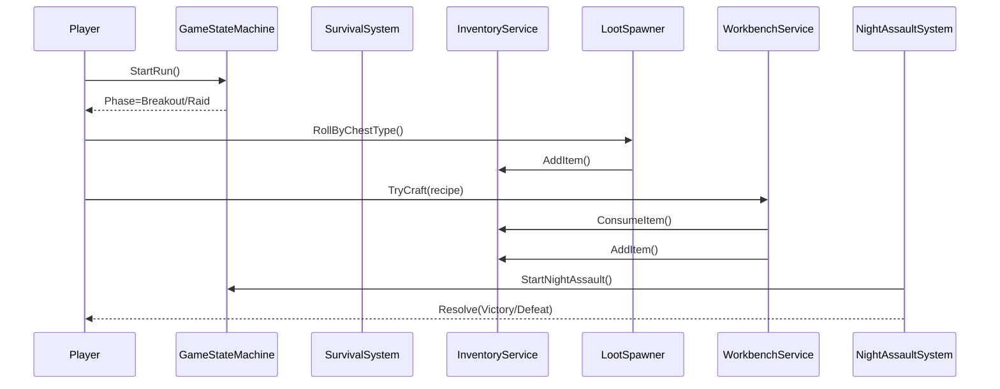
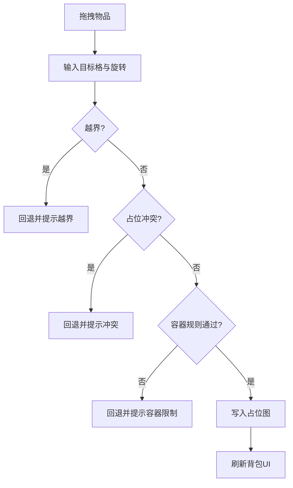

# 末日摸金生存游戏：核心玩法系统与开发执行文档（V1.2）

## 文档信息

| 字段 | 内容 |
|---|---|
| 文档状态 | Draft（可执行） |
| 当前版本 | v1.3.0 |
| 最后更新 | 2026-07-23 |
| 适用范围 | 玩法、程序、策划、测试、技术美术 |
| 关联代码目录 | `Assets/Scripts` |
| 规范要求 | 注释完整；编辑器展示统一使用 Odin Inspector |

## 版本记录

| 版本 | 日期 | 变更摘要 |
|---|---|---|
| v1.3.0 | 2026-07-23 | 更新当前实现基线：网格背包、世界拾取、可搜索容器、逐物品搜索已进入样机收尾阶段；下一阶段先完成状态持久化和稳定性验证，再开发撤离点 |
| v1.2.0 | 2026-03-25 | 新增“网格背包系统程序实现拆解”，包含类设计、接口、UI事件流、存档结构、测试用例与任务排期 |
| v1.1.0 | 2026-03-25 | 新增“网格背包系统（类三角洲）”专项章节，补齐交互规则、数据结构、摆放算法、参数配置、排期与验收 |
| v1.0.0 | 2026-03-25 | 基于当前代码与玩法目标，建立系统说明、数据结构、算法流程、配置参数、开发排期与验收标准 |

---

## 目录

- [1. 目标与范围](#1-目标与范围)
- [2. 当前实现基线](#2-当前实现基线)
- [3. 核心玩法闭环](#3-核心玩法闭环)
- [4. 系统设计总览](#4-系统设计总览)
- [5. 系统详细设计](#5-系统详细设计)
  - [5.1 玩家素材管理系统](#51-玩家素材管理系统)
  - [5.2 生存状态系统](#52-生存状态系统)
  - [5.3 战斗机制系统](#53-战斗机制系统)
  - [5.4 摸金探索系统](#54-摸金探索系统)
  - [5.5 突围路线系统](#55-突围路线系统)
  - [5.6 庇护所与工作台系统](#56-庇护所与工作台系统)
  - [5.7 夜袭防守系统](#57-夜袭防守系统)
  - [5.8 状态机与事件总线](#58-状态机与事件总线)
  - [5.9 存档系统](#59-存档系统)
  - [5.10 UI与调试系统](#510-ui与调试系统)
  - [5.11 网格背包系统（类三角洲）](#511-网格背包系统类三角洲)
- [6. 关键数据结构设计](#6-关键数据结构设计)
- [7. 关键算法流程](#7-关键算法流程)
- [8. 配置参数规范](#8-配置参数规范)
- [9. 可视化示意图](#9-可视化示意图)
- [10. 开发安排与优先级](#10-开发安排与优先级)
- [11. 测试与验收标准](#11-测试与验收标准)
- [12. 团队协作与文档规范](#12-团队协作与文档规范)
- [13. 网格背包系统程序实现拆解](#13-网格背包系统程序实现拆解)
- [14. 地图制作规则（SmallScaleInt / Isometric Z as Y）](#14-地图制作规则smallscaleint--isometric-z-as-y)

---

## 1. 目标与范围

本项目定位为“**生存压力驱动的摸金循环**”：玩家在庇护所准备，突围进入摸金点获取资源，夜间防守并结算，再进入下一轮循环。  
本文档用于统一玩法、开发与测试实现口径，确保“设计可开发、开发可验证、验证可回归”。

---

## 2. 当前实现基线

> 交叉引用：详见 [5.8 状态机与事件总线](#58-状态机与事件总线)、[5.2 生存状态系统](#52-生存状态系统)。

当前已具备可运行的样机级能力：

- 主循环阶段切换（Shelter / Breakout / Raid / NightAssault / Result）
- 生存数值衰减与惩罚（饥饿、口渴、疲劳、感染、HP）
- 背包堆叠、消耗、计数
- 网格背包：多容器、占格、旋转、拖拽、快速转移和编辑器可视化
- 掉落按箱体类型 + 权重抽取
- 世界露天物资拾取与可搜索容器
- 容器首次搜索、JSON 掉落生成、容器 UI 开关
- 容器内物品按品质逐件搜索和蒙版揭示
- 场景中可编辑的交互提示 UI 与容器 UI
- 工作台配方校验与制造
- 庇护所饮水/休息/供电状态事件
- 夜袭开始、波次推进、胜利奖励结算
- Runtime 调试面板与调试动作入口
- Inspector 提示迁移至 Odin `PropertyTooltip`

当前收尾重点：

- 统一交互参数配置来源，禁止 Bootstrap 覆盖玩家组件中的策划调参。
- 为搜索容器建立稳定 ID 和可接入总存档的状态快照。
- 验证多容器、离开范围、背包已满、重新打开和场景重载等边界情况。
- 搜索与物资闭环稳定后，再进入撤离点/突围路线的最小可玩实现。

---

## 3. 核心玩法闭环

1. **庇护所准备**：检查生存状态、整理背包、选择配方与补给。  
2. **突围阶段**：消耗弹药与体力，收集基础生存资源。  
3. **摸金阶段**：高风险高收益，获取稀有资源、蓝图与关键材料。  
4. **回撤结算**：按收益更新背包与模块进度。  
5. **夜袭防守**：根据防御、能源、武器状态决定胜负。  
6. **结果与下一轮**：结算奖励/损耗，进入新循环。

---

## 4. 系统设计总览

| 系统 | 定位 | 当前状态 | 下一阶段目标 |
|---|---|---|---|
| 玩家素材管理 | 资源流核心 | 已有背包基础 | 数据化配置 + 稀缺资源体系 |
| 生存状态 | 压力与惩罚源 | 已可运行 | UI可视化 + 平衡参数外置 |
| 战斗机制 | 风险来源 | 框架待完善 | 伤害模型、耐久、武器分层 |
| 摸金探索 | 收益来源 | 掉落基础已具备 | 场景交互、机关、污染事件 |
| 突围路线 | 资源补给与战斗场 | 待完善 | 节点化路线、随机事件 |
| 网格背包 | 资源管理交互核心 | 未实现 | 二维占位、旋转放置、容器嵌套、快速整理 |
| 庇护所与工作台 | 成长与转化 | 基础可用 | 多模块联动、蓝图解锁 |
| 夜袭防守 | 回合压力峰值 | 基础流程可用 | 敌群/目标/胜负条件实装 |
| 存档系统 | 持久化 | 未实现 | 可中断续玩与版本兼容 |
| UI系统 | 玩家操作入口 | 调试面板为主 | 正式HUD与交互界面 |

---

## 5. 系统详细设计

## 5.1 玩家素材管理系统

### 功能说明
- 管理物品堆叠、容量、增减、来源与去向。
- 支撑生存消耗、工作台制造、夜袭补给、任务奖励。
- 当前为“列表堆叠背包”基线，后续升级到 [5.11 网格背包系统（类三角洲）](#511-网格背包系统类三角洲)。

### 交互逻辑
- 外部系统（摸金、突围、夜袭、工作台）只通过 `AddItem/ConsumeItem/CountItem` 交互。
- 当新增物品时优先补同类堆叠，再创建新堆叠，直至容量上限。

### 数据结构设计
- `ItemStack { string itemId; int quantity; }`
- `InventoryService`：`maxSlots`、`defaultStackLimit`、`List<ItemStack> stacks`

### 关键实现要点
- 同类堆叠补齐 + 新堆叠创建的双阶段填充策略。
- 逆序消耗减少移除成本。
- 对无效 `itemId` 与 `amount<=0` 做防御式校验。

### 配置参数说明

| 参数 | 含义 | 默认值 | 调整建议 |
|---|---|---:|---|
| `maxSlots` | 背包格子上限 | 20 | 前期 16-24，后期可升级 |
| `defaultStackLimit` | 单堆叠上限 | 99 | 稀有资源建议更低上限 |

### 预期交付物
- 物品主数据表（ID、类型、堆叠上限、价值、用途）
- 背包 UI 与拖拽拆分逻辑

### 验收标准
- 背包满时新增受阻，日志或UI提示明确。
- 同 ID 物品自动合并，数量正确。
- 消耗后堆叠为 0 自动移除。

---

## 5.2 生存状态系统

### 功能说明
- 维护 `hunger/thirst/fatigue/hp/infected` 及派生属性。
- 提供吃喝睡、感染治疗、持续惩罚与状态事件。

### 交互逻辑
- `Update` 每帧 Tick 衰减与惩罚。
- 庇护所与消耗品通过 `Eat/Drink/Sleep/CureInfection` 调整状态。
- 派生属性影响战斗与移动系统（跨系统依赖）。

### 数据结构设计
- 运行时状态：`hunger、thirst、fatigue、hp、infected`
- 计时器：`hungerTimer、thirstTimer、fatigueTimer、hpPenaltyTimer`
- 派生参数：`MoveSpeedMultiplier、DamageMultiplier、StaminaMultiplier、CanUseChargeAttack`

### 关键实现要点
- 分离“衰减周期”和“每分钟惩罚”两个时钟。
- 所有核心数值统一 `0-100` 裁剪。
- 惩罚阈值配置化，便于平衡测试。

### 配置参数说明

| 参数 | 默认值 | 说明 |
|---|---:|---|
| `hungerIntervalSeconds` | 480 | 饥饿衰减周期 |
| `thirstIntervalSeconds` | 480 | 口渴衰减周期 |
| `fatigueIntervalSeconds` | 1440 | 疲劳衰减周期 |
| `warningThreshold` | 30 | 警告阈值 |
| `criticalThreshold` | 10 | 危险阈值 |
| `hpLossPerMinuteWhenHungry` | 3 | 饥饿掉血速率 |
| `hpLossPerMinuteWhenThirsty` | 5 | 缺水掉血速率 |
| `hpLossPerMinuteWhenInfected` | 2 | 感染掉血速率 |

### 预期交付物
- 生存 HUD（进度条 + 状态图标 + 告警）
- 生存参数 ScriptableObject

### 验收标准
- 10 分钟挂机后，衰减与惩罚曲线符合配置。
- 吃喝睡即时生效且不会越界。
- 感染状态可通过医疗行为解除。

---

## 5.3 战斗机制系统

### 功能说明
- 提供近战/远程伤害结算、命中判定、耐久消耗、受击反馈。
- 让生存状态（饥饿/疲劳）切实影响输出与操作能力。

### 交互逻辑
- 输入系统触发攻击 -> 武器组件生成攻击请求 -> 伤害系统结算 -> 目标反馈。
- 每次攻击按武器类型扣耐久，耐久低于阈值触发性能衰减。
- 与 [5.6 庇护所与工作台系统](#56-庇护所与工作台系统) 联动修复与升级。

### 数据结构设计（建议）
- `WeaponDefinition`：基础伤害、攻速、耐久上限、穿透、暴击、修复材料
- `DamageContext`：攻击方、目标、命中部位、距离、伤害类型、倍率
- `WeaponRuntimeState`：currentDurability、isBroken

### 关键算法流程
- 伤害 = 基础伤害 × 生存倍率 × 命中部位倍率 × 护甲穿透修正 × 随机浮动。
- 耐久扣减 = 基础消耗 × 武器类别系数 × 环境系数（如重击/防御碰撞）。

### 配置参数说明
- 近战基础伤害区间、射击扩散、爆头倍率、耐久消耗速率、破损阈值。

### 预期交付物
- 武器主数据 + 战斗结算模块 + 命中反馈（音效/飘字/受击动画）

### 验收标准
- 近战/远程完整可打通，且耐久消耗与修复可闭环。
- 生存状态导致输出/机动变化有明确体感。

---

## 5.4 摸金探索系统

### 功能说明
- 在高风险区域进行搜刮、解谜、开箱、躲陷阱，获取高价值资源。

### 交互逻辑
- 玩家进入摸金点 -> 触发场景事件 -> 开箱/机关判定 -> 产出掉落 -> 可能附带感染/噪声惩罚。
- 与掉落系统联动：`LootChestType` 驱动掉落池。

### 数据结构设计（建议）
- `RaidPointDefinition`：难度、噪声值、污染值、箱体分布
- `LootChestSpawn`：类型、位置、权重组、刷新条件
- `TrapDefinition`：触发条件、效果（伤害/感染/报警）

### 关键实现要点
- 分层掉落池（生存、武器、资源、稀有、医疗）。
- 风险收益挂钩：高风险点提高稀有蓝图概率。
- 污染陷阱与感染系统联动。

### 预期交付物
- 1 个标准摸金点 + 1 个高风险摸金点
- 开箱交互组件、陷阱组件、掉落配置资产

### 验收标准
- 每次探索都可形成“收益+风险”反馈，非纯随机堆物。
- 稀有掉落概率符合配置曲线。

---

## 5.5 突围路线系统

### 功能说明
- 承担“战斗消耗 + 资源补给 + 节奏过渡”作用。

### 交互逻辑
- 节点式推进：补给点/战斗点/事件点/捷径点。
- 路线事件影响当轮状态（弹药、感染、疲劳、时间消耗）。

### 数据结构设计（建议）
- `RouteNode`：节点类型、敌人组、资源点、触发器
- `RouteEvent`：概率、条件、收益/惩罚

### 关键实现要点
- 节点化配置 + 随机扰动，保证可复玩。
- 与生存资源采集（野菜/污水/木材/矿石）联动。

### 预期交付物
- 1 条完整突围样例路线（含 6-8 节点）

### 验收标准
- 可稳定从起点推进至终点，且事件结果可复现可测试。

---

## 5.6 庇护所与工作台系统

### 功能说明
- 庇护所负责恢复、储备与防守准备；工作台负责加工、制造、修复与升级。

### 交互逻辑
- 庇护所模块提供恢复与供电状态。
- 工作台校验配方与材料，成功后产出并回写背包。
- 蓝图与等级共同约束高级配方解锁。

### 数据结构设计
- `WorkbenchRecipe`：`recipeId`、`requiredWorkbenchLevel`、`outputItemId`、`outputQuantity`、`requirements`
- `WorkbenchMaterialRequirement`：`itemId`、`quantity`

### 关键实现要点
- 配方有效性校验（空 ID、非法数量）前置。
- 消耗与产出分步执行，保障事务完整性。
- 支持后续扩展为“队列制造”。

### 配置参数说明
- 工作台等级成长曲线、配方耗材、制造耗时、电力消耗。

### 预期交付物
- 工作台正式 UI、配方分类、蓝图解锁流程

### 验收标准
- 配方解锁条件正确，材料不足阻止制造并提示原因。
- 修复消耗规则与武器耐久系统一致。

---

## 5.7 夜袭防守系统

### 功能说明
- 夜间回合压力峰值，验证白天准备质量（资源、防御、武器、状态）。

### 交互逻辑
- `StartAssault` 进入夜袭并发预警事件。
- 波次推进后按胜负结算奖励/损耗。
- 结果回写主循环状态机进入结算阶段。

### 数据结构设计
- `NightAssaultResult`：`Victory/Defeat`
- `NightAssaultStartedEvent`、`NightAssaultResolvedEvent`

### 关键实现要点
- 防御工事与能源状态联动（断电降效）。
- 奖励与风险挂钩（胜利奖励、失败惩罚）。

### 预期交付物
- 夜袭 AI 波次配置、目标点系统、结算界面

### 验收标准
- 胜利与失败路径都可稳定触发，奖励/惩罚逻辑正确。

---

## 5.8 状态机与事件总线

### 功能说明
- 状态机控制主循环阶段，事件总线负责系统解耦通信。

### 交互逻辑
- 状态切换时发布 `GamePhaseChangedEvent`。
- 生存系统每帧发布 `SurvivalTickEvent`。
- 夜袭/掉落/供电事件用于 UI、任务、日志监听。

### 数据结构设计
- `GamePhase` 枚举
- `EventBus`：`Subscribe/Unsubscribe/Publish`

### 关键实现要点
- 事件对象不可变结构体，减少误修改。
- 订阅管理需在生命周期中成对注册/注销。

### 预期交付物
- 统一事件命名规范与事件追踪面板（开发态）

### 验收标准
- 阶段切换与关键业务事件均可被 UI/日志系统监听并正确响应。

---

## 5.9 存档系统

### 功能说明
- 支持中断续玩、跨会话恢复、版本升级兼容。

### 交互逻辑
- 手动保存、阶段结算自动保存、异常退出恢复。
- 读取时按版本号执行迁移策略。

### 数据结构设计（建议）
- `SaveData`：版本号、阶段、生存状态、背包、工作台等级、夜袭进度、时间戳。

### 关键实现要点
- 原子写入（临时文件 + 替换）避免坏档。
- 字段扩展保持向后兼容。

### 预期交付物
- `SaveService`、存档槽 UI、兼容策略说明

### 验收标准
- 存读一致、跨版本可降级读取、坏档不崩溃。

---

## 5.10 UI与调试系统

### 功能说明
- 正式 UI 承担玩家交互；调试 UI 服务联调与测试。

### 交互逻辑
- 正式 UI 监听事件总线更新显示。
- 调试面板保留开发期开关，发行版可禁用。

### 数据结构设计
- UI ViewModel（建议）：状态快照、通知字段、格式化文本。

### 关键实现要点
- 业务状态与 UI 展示解耦，避免双向污染。
- Inspector 统一 Odin 展示与注释规范。

### 预期交付物
- HUD、背包、工作台、夜袭结算、设置界面

### 验收标准
- 不依赖调试按钮即可完成完整游戏循环。

---

## 5.11 网格背包系统（类三角洲）

### 功能说明
- 采用二维网格占位管理背包内容，物品拥有宽高尺寸、旋转状态与占位形状。
- 支持“主背包 + 口袋 + 挂载容器（包中包）”结构，强化资源管理决策深度。
- 支持拖拽放置、自动吸附、冲突提示、快速整理与快速转移。

### 交互逻辑
- 玩家拖拽物品时，系统实时显示可放置区域（绿色）与冲突区域（红色）。
- 释放时执行合法性判定：边界、占用冲突、容器类型约束、重量/容量约束。
- 旋转操作（默认 `R`）会交换 `width/height` 并重新判定。
- 双击或快捷键触发“快速转移”时，按容器优先级执行自动摆放。

### 数据结构设计（建议）
- `GridContainerDefinition`
  - `containerId`
  - `rows`
  - `columns`
  - `allowNestedContainer`
  - `allowedItemTags`
- `GridItemDefinition`
  - `itemId`
  - `width`
  - `height`
  - `canRotate`
  - `maxStack`
  - `itemTags`
  - `weight`
- `GridItemInstance`
  - `instanceId`
  - `itemId`
  - `stackCount`
  - `rotation`（0/90）
  - `containerId`
  - `originRow`
  - `originColumn`
- `GridOccupancyMap`
  - `bool[,] occupied`
  - `string[,] occupantInstanceId`

### 关键算法流程
- **放置校验（CanPlace）**
  1. 根据旋转态计算实际占位宽高。
  2. 校验原点与矩形占位是否越界。
  3. 遍历占位矩形，判断是否与已有实例冲突。
  4. 校验容器标签与嵌套规则。
  5. 全部通过返回可放置。
- **自动摆放（AutoPlace）**
  1. 按容器优先级与物品价值排序。
  2. 对每个物品执行“左上到右下”首个可放位置搜索。
  3. 若不可放，尝试旋转后再次搜索。
  4. 仍失败则加入“未放入列表”并反馈 UI。
- **快速整理（AutoSort）**
  1. 提取容器内全部实例并清空占位图。
  2. 先放大体积高价值物品，再放小体积补缝物品。
  3. 重建占位图并刷新 UI。

### 配置参数说明

| 参数 | 含义 | 默认建议 |
|---|---|---:|
| `mainBagRows` | 主背包行数 | 8 |
| `mainBagColumns` | 主背包列数 | 10 |
| `pocketRows` | 口袋行数 | 2 |
| `pocketColumns` | 口袋列数 | 3 |
| `quickTransferPolicy` | 快速转移策略（FirstFit/BestFit） | FirstFit |
| `autoSortEnabled` | 是否允许一键整理 | true |
| `nestedContainerDepth` | 容器嵌套层级上限 | 1 |
| `maxCarryWeight` | 最大可携带重量 | 35 |

### 可视化示意图

```text
主背包（8x10）示意：
+-------------------------------------------------+
| [2x3步枪] [2x2医疗包] [1x3弹匣] [2x1食物]      |
| [2x3步枪] [2x2医疗包] [1x3弹匣] [2x1食物]      |
| [2x3步枪] [1x1水]    [1x1钥匙] [3x2工具箱]     |
| ...                                             |
+-------------------------------------------------+
```

### 预期交付物
- 网格背包运行时模型（容器、实例、占位图）
- 背包 UI（拖拽、旋转、高亮、快速转移、一键整理）
- 物品尺寸配置表与容器配置资产（ScriptableObject）
- 与现有 `InventoryService` 的兼容适配层（旧接口不破坏）

### 验收标准
- 任意放置操作 100% 满足边界/冲突约束，不出现“穿模占位”。
- 旋转后占位正确刷新，撤销/还原位置一致。
- 快速转移与整理结果可复现，不丢失物品实例。
- 多容器切换（主包/口袋/挂载包）性能稳定，无明显卡顿。

---

## 6. 关键数据结构设计

| 结构 | 来源 | 说明 |
|---|---|---|
| `ItemStack` | 已实现 | 背包堆叠基础单元 |
| `LootEntry` | 已实现 | 掉落条目，包含类型、数量区间、权重 |
| `WorkbenchRecipe` | 已实现 | 配方定义，含等级与材料要求 |
| `GamePhaseChangedEvent` | 已实现 | 阶段切换广播 |
| `NightAssaultResolvedEvent` | 已实现 | 夜袭结果广播 |
| `SaveData` | 待开发 | 存档主结构，需版本化 |
| `WeaponDefinition` | 待开发 | 武器配置结构 |
| `GridContainerDefinition` | 待开发 | 网格容器定义（行列、规则） |
| `GridItemInstance` | 待开发 | 网格物品运行时实例（位置、旋转、数量） |
| `GridOccupancyMap` | 待开发 | 占位图，用于冲突判定与渲染 |

---

## 7. 关键算法流程

### 7.1 掉落权重抽取
1. 根据箱体类型过滤掉落池。  
2. 汇总总权重 `totalWeight`。  
3. 随机 `roll in [1,totalWeight]`。  
4. 累加游标命中后返回条目。  
5. 按 `min/max` 随机数量生成 `ItemStack`。

### 7.2 生存衰减与惩罚
1. 每帧累加各计时器。  
2. 达到周期则扣减对应数值并回拨计时器。  
3. 每 60 秒执行危险状态掉血。  
4. 重算移动/伤害/体力等派生倍率。

### 7.3 工作台制造事务
1. 校验配方存在与等级满足。  
2. 校验材料足够。  
3. 扣减材料。  
4. 发放产出；失败时记录告警并回滚策略（待实现）。

### 7.4 网格背包放置与整理
1. 接收拖拽目标位置与旋转态。  
2. 执行 `CanPlace` 判定（越界/冲突/容器规则）。  
3. 可放置则更新 `GridOccupancyMap` 与 `GridItemInstance`。  
4. 不可放置则回退原位并提示冲突原因。  
5. 触发整理时执行 `AutoSort`，并返回未能放入的实例列表。

---

## 8. 配置参数规范

| 配置域 | 推荐格式 | 热更需求 | 责任角色 |
|---|---|---|---|
| 生存参数 | ScriptableObject | 高 | 策划/程序 |
| 掉落表 | ScriptableObject + CSV 导入 | 高 | 策划 |
| 配方表 | ScriptableObject | 中 | 策划 |
| 夜袭波次 | ScriptableObject | 高 | 策划/关卡 |
| 武器主数据 | ScriptableObject | 高 | 战斗策划 |
| 网格背包配置 | ScriptableObject | 高 | 系统策划/程序 |

参数命名规范：
- 统一英文 `camelCase` 字段；单位写入后缀（如 `IntervalSeconds`）。
- 所有可调参数必须有中文 Odin 提示 `PropertyTooltip`。

---

## 9. 可视化示意图

### 9.1 玩法主循环


### 9.2 核心系统交互时序



### 9.3 网格背包放置判定流程



---

## 10. 开发安排与优先级

### 阶段目标

| 阶段 | 周期 | 核心目标 | 关键交付 |
|---|---|---|---|
| Phase A（P0） | 1-3 周 | 主循环可玩 + 配置数据化 + 存档 + 网格背包底层 | 编排器、SO 配置、SaveService、Grid Runtime |
| Phase B（P1） | 4-7 周 | 战斗与摸金深化 + 正式 UI + 网格背包交互 | 战斗结算、摸金场景、HUD/网格背包/工作台 |
| Phase C（P1） | 8-10 周 | 夜袭完整化 + 庇护所多模块联动 | 波次AI、防御工事、能源系统 |
| Phase D（P2） | 11-12 周 | 测试稳定性 + 平衡与体验优化 | 自动化测试、参数调优、性能优化 |

### 优先级建议

1. **P0：主循环编排器 + 数据化配置 + 存档 + 网格背包运行时**（先保证“可玩且可持续迭代”）  
2. **P1：战斗与摸金、正式 UI、网格背包交互、夜袭完整化**（提升可玩性与体验）  
3. **P2：任务引导、自动化测试、性能与内容扩展**（提升稳定性与留存）

---

## 11. 测试与验收标准

### 功能验收

| 测试项 | 验收标准 |
|---|---|
| 主循环 | 可连续完成 3 轮无阻塞 |
| 生存系统 | 衰减、惩罚、恢复符合参数 |
| 掉落系统 | 权重分布统计误差在可接受区间 |
| 工作台 | 材料校验、消耗、产出一致 |
| 夜袭 | 胜败路径与奖励惩罚正确 |
| 存档 | 保存读取一致，坏档不崩溃 |
| 网格背包 | 放置冲突、旋转、整理、转移规则正确且无丢物 |

### 非功能验收
- 关键场景帧率稳定，内存无明显泄漏。
- 错误日志可定位，关键事件有统一追踪字段。
- 文档与配置保持一致，提交需同步更新版本记录。

---

## 12. 团队协作与文档规范

- 本文档按版本号维护，新增系统需补充“功能/交互/数据/算法/参数/验收”六要素。
- 代码实现必须包含中文注释（类、字段、关键方法）。
- Inspector 展示统一使用 Odin（`PropertyTooltip`、`LabelText`、`BoxGroup`、`FoldoutGroup` 等）。
- 配置参数优先数据化，不将平衡参数硬编码在业务逻辑中。
- 测试用例与需求条目建立双向追踪（需求 ID ↔ 用例 ID）。

---

## 13. 网格背包系统程序实现拆解

> 交叉引用：本章节落地 [5.11 网格背包系统（类三角洲）](#511-网格背包系统类三角洲) 的设计要求，并与 [5.9 存档系统](#59-存档系统)、[5.10 UI与调试系统](#510-ui与调试系统) 联动实现。

### 13.1 模块边界与目录规划

建议目录（按当前工程习惯）：

- `Assets/Scripts/Inventory/Grid/Core`
  - 网格背包核心模型与算法
- `Assets/Scripts/Inventory/Grid/Runtime`
  - 运行时服务与事件桥接
- `Assets/Scripts/Inventory/Grid/UI`
  - UI 视图与交互控制器
- `Assets/Scripts/Inventory/Grid/Config`
  - ScriptableObject 配置定义
- `Assets/Scripts/Inventory/Grid/Save`
  - 存档映射与版本迁移

职责划分：

- `Core` 不依赖 Unity UI，仅处理规则与数据。
- `Runtime` 组织容器、实例与业务流程。
- `UI` 只消费 ViewModel 和命令接口，不直接改写底层数据。
- `Save` 负责运行时与持久化结构互转。

### 13.2 类设计（Class Design）

核心类建议：

| 类名 | 类型 | 责任 |
|---|---|---|
| `GridInventoryService` | Service | 对外统一入口：放置、移动、旋转、拆分、转移、整理 |
| `GridContainerRuntime` | Runtime Model | 单容器运行时状态：占位图、实例索引、容量限制 |
| `GridItemRuntime` | Runtime Model | 物品实例状态：位置、旋转、数量、绑定容器 |
| `GridPlacementSolver` | Domain Service | `CanPlace` / `FindFit` / `FindFitWithRotation` |
| `GridAutoSortService` | Domain Service | 一键整理策略执行 |
| `GridTransferService` | Domain Service | 跨容器快速转移策略执行 |
| `GridInventoryPresenter` | UI Presenter | 将 Runtime 转为 UI 可绘制数据 |
| `GridSaveMapper` | Mapper | Runtime ↔ SaveData 双向转换 |

推荐关系：

```text
UI(Input) -> GridInventoryService
GridInventoryService -> Solver/Sort/Transfer
GridInventoryService -> ContainerRuntime/ItemRuntime
GridInventoryService -> EventBus(背包变更事件)
SaveService <-> GridSaveMapper <-> GridInventoryService
```

### 13.3 接口定义（Interface Contract）

对外业务接口：

```csharp
public interface IGridInventoryService
{
    bool TryPlace(string itemInstanceId, string containerId, int row, int col, int rotation);
    bool TryMove(string itemInstanceId, string targetContainerId, int targetRow, int targetCol);
    bool TryRotate(string itemInstanceId);
    bool TrySplitStack(string itemInstanceId, int splitCount, out string newInstanceId);
    bool TryMergeStack(string sourceInstanceId, string targetInstanceId);
    bool TryQuickTransfer(string itemInstanceId);
    GridAutoSortResult AutoSort(string containerId);
    GridInventorySnapshot BuildSnapshot();
}
```

UI 命令接口：

```csharp
public interface IGridInventoryUICommand
{
    void BeginDrag(string itemInstanceId);
    void HoverCell(string containerId, int row, int col);
    void ConfirmDrop(string containerId, int row, int col);
    void CancelDrag();
    void RotateDraggingItem();
}
```

事件接口（建议走现有 EventBus）：

- `GridItemPlacedEvent`
- `GridItemMovedEvent`
- `GridItemRotatedEvent`
- `GridItemTransferFailedEvent`
- `GridInventoryChangedEvent`

### 13.4 UI 事件流（Event Flow）

标准拖拽放置流程：

1. `BeginDrag` 读取实例状态并创建拖拽影像。  
2. `HoverCell` 连续请求 `CanPlace`，刷新高亮颜色。  
3. 用户按 `R` 触发 `RotateDraggingItem`，实时重算占位。  
4. `ConfirmDrop` 调用 `TryPlace`。  
5. 成功：提交状态并广播 `GridInventoryChangedEvent`。  
6. 失败：回退原位置并弹出原因提示。

快速转移流程：

1. 双击实例触发 `TryQuickTransfer`。  
2. 系统按“口袋 -> 主包 -> 挂载包”优先级搜索目标容器。  
3. 使用 `FindFitWithRotation` 尝试放置。  
4. 成功则刷新两侧容器；失败则提示“空间不足/容器不兼容”。

### 13.5 存档结构（Save Schema）

建议在 `SaveData` 增加字段：

```json
{
  "gridInventoryVersion": 1,
  "containers": [
    {
      "containerId": "main_bag",
      "rows": 8,
      "columns": 10,
      "items": [
        {
          "instanceId": "itm_001",
          "itemId": "rifle_ak",
          "stackCount": 1,
          "rotation": 90,
          "originRow": 1,
          "originColumn": 4
        }
      ]
    }
  ]
}
```

兼容策略：

- `gridInventoryVersion=0`（旧列表背包）读档时走迁移：按默认规则执行 `AutoPlace` 导入网格容器。
- 迁移失败实例写入“邮箱/暂存箱”避免丢失。
- 读档阶段对越界与冲突执行二次修正。

### 13.6 与现有 InventoryService 兼容方案

兼容目标：

- 不破坏旧调用方（`AddItem/ConsumeItem/CountItem`）。
- 新旧系统可并行一段时间，逐步替换调用点。

适配策略：

- 新增 `GridInventoryAdapter`，对外实现旧接口语义。
- `AddItem`：创建实例后调用 `TryQuickTransfer` 或 `AutoPlace`。
- `ConsumeItem`：按“同 ID + 最小价值优先”逆序消耗实例。
- `CountItem`：聚合同 ID 实例 `stackCount`。

### 13.7 性能与实现约束

- 占位判定复杂度：单次 `O(w*h)`；快速转移最坏 `O(containerCount * rows * cols * w * h)`。
- 目标性能：
  - 拖拽悬停判定 < 1ms（PC 基准机）
  - 一键整理 100 个实例 < 40ms
- 优化手段：
  - 容器空位索引缓存
  - 脏区刷新而非全量重绘
  - UI 层对象池复用

### 13.8 测试用例清单（可直接转测试平台）

| 用例ID | 场景 | 步骤 | 预期 |
|---|---|---|---|
| GI-001 | 基础放置 | 将 2x2 物品放入空容器 | 成功占位，无冲突 |
| GI-002 | 越界拦截 | 将 2x3 物品放在右下角越界位置 | 放置失败并提示越界 |
| GI-003 | 冲突拦截 | 放置到已有实例占位区域 | 放置失败并提示冲突 |
| GI-004 | 旋转放置 | 3x1 物品旋转为 1x3 后放置 | 可放时成功，坐标正确 |
| GI-005 | 快速转移 | 双击物品自动转入目标容器 | 成功移动或给出空间不足提示 |
| GI-006 | 一键整理 | 容器含混乱摆放实例后整理 | 占位重排成功，无实例丢失 |
| GI-007 | 栈拆分合并 | 30 发子弹拆分 10，再合并 | 数量守恒，位置合法 |
| GI-008 | 存档回读 | 保存后重启读取背包 | 位置、旋转、数量一致 |
| GI-009 | 迁移读档 | 旧存档导入网格背包 | 物品不丢失，异常进暂存箱 |
| GI-010 | 压力测试 | 200 次拖拽/旋转连续操作 | 无崩溃、无重复实例、无负数数量 |

### 13.9 开发任务拆解（程序与UI）

| 任务ID | 任务项 | 负责人角色 | 依赖 | 输出物 |
|---|---|---|---|---|
| GDEV-01 | 建立 Grid Core 数据结构与 Solver | 程序 | 无 | `Core` 模块代码 |
| GDEV-02 | 实现 GridInventoryService 与事件 | 程序 | GDEV-01 | 运行时服务 |
| GDEV-03 | 实现 Adapter 兼容旧背包接口 | 程序 | GDEV-02 | 兼容层 |
| GDEV-04 | 实现背包 UI 网格与拖拽 | UI程序 | GDEV-02 | 网格UI |
| GDEV-05 | 实现旋转/快转/整理交互 | UI程序 | GDEV-04 | 交互功能 |
| GDEV-06 | 实现存档映射与迁移 | 程序 | GDEV-02 | Save Mapper |
| GDEV-07 | 编写自动化测试与回归脚本 | 程序/测试 | GDEV-02~06 | 测试集 |
| GDEV-08 | 与战利品、工作台、商店对接 | 程序 | GDEV-03 | 业务联调 |

### 13.10 里程碑与完成定义（DoD）

里程碑建议：

- `M1`：核心放置、移动、旋转可用（GDEV-01~02）
- `M2`：UI 拖拽与快速操作可用（GDEV-04~05）
- `M3`：存档与旧档迁移可用（GDEV-06）
- `M4`：业务联调与回归通过（GDEV-07~08）

每个里程碑 DoD：

- 关键功能通过对应测试用例。
- 与现有主循环联调不阻断。
- 文档与配置同步更新（版本记录、参数表、用例表）。

---

## 附录：当前代码映射（便于查阅）

- 主循环状态机：`Assets/Scripts/Core/GameStateMachine.cs`
- 事件总线与事件：`Assets/Scripts/Core/EventBus.cs`、`Assets/Scripts/Core/GameplayRuntimeEvents.cs`
- 生存系统：`Assets/Scripts/Survival/SurvivalSystem.cs`
- 背包系统：`Assets/Scripts/Inventory/InventoryService.cs`
- 掉落系统：`Assets/Scripts/Gameplay/Loot/LootSpawner.cs`
- 工作台系统：`Assets/Scripts/Gameplay/Workbench/WorkbenchService.cs`
- 庇护所系统：`Assets/Scripts/Gameplay/Shelter/ShelterModuleService.cs`
- 夜袭系统：`Assets/Scripts/Gameplay/Night/NightAssaultSystem.cs`
- 启动与调试：`Assets/Scripts/Gameplay/GameBootstrap.cs`、`Assets/Scripts/Gameplay/RuntimeDebugPanel.cs`

---

## 14. 地图制作规则（SmallScaleInt / Isometric Z as Y）

### 14.1 当前地图制作结论

- 当前使用资源：`Assets/SmallScaleInt`
- 当前地图网格：`Isometric Z as Y`
- 当前地图工具：`Assets/Scripts/Editor/MapTools/MapTilemapTools.cs`
- 当前推荐方式：`Tilemap` 负责地面、结构、遮挡与碰撞；家具、门、箱子、桌椅、可交互物尽量做成 `Prefab`

说明：

- 这批新瓦片在 `Rectangular` 下不容易正确对位，当前以实际摆放效果为准，统一使用 `Isometric Z as Y`。
- `Grid` 与标准 Tilemap 层可通过菜单 `Tools/Map/Create Standard Tilemap Layers` 或 `Tools/Map/Upgrade Legacy Tilemap Layers` 自动创建/升级。

### 14.2 标准 Tilemap 分层

| 层名 | 作用 | 是否建议放碰撞 |
|---|---|---|
| `GroundBase` | 主地面：木地板、地砖、水泥地、室外基础地表 | 否 |
| `GroundDetail` | 污渍、血迹、裂缝、阴影底纹等地面细节 | 否 |
| `LowDeco` | 地毯、低矮地面装饰、地贴类杂物 | 否 |
| `WallBack` | 背景墙、角色永远显示在其前方的墙体视觉 | 否 |
| `Collision` | 专门负责阻挡移动的隐藏/功能层 | 是 |
| `WallFront` | 门框、前景墙、玻璃隔断等可能挡住角色的结构 | 视需要而定，通常不直接放 |
| `RoofOrCover` | 屋顶、房间遮罩、需要后续做隐藏/淡出的覆盖层 | 否 |
| `Foreground` | 必须压在角色前面的装饰层，如近景遮挡 | 否 |
| `Interactable` | 编辑辅助标记、少量交互占位 Tile | 否 |

### 14.3 各层实际摆放规则

#### `GroundBase`

- 先铺满主要可行走区域。
- 只放基础地面，不放碰撞。
- 一张地图优先保证这一层完整，再做细节。

#### `GroundDetail`

- 只叠加视觉细节，不改变通行逻辑。
- 适合放血迹、污渍、裂缝、脏污边角。
- 不要把“会挡路”的东西放在这一层。

#### `LowDeco`

- 适合地毯、低矮贴花、地面杂物。
- 如果某个物件后续可能要交互、搜索、破坏或单独加碰撞，改做 `Prefab`，不要继续画在这层。

#### `WallBack`

- 放房间后墙、走廊后墙、靠上方的视觉结构。
- 角色通常永远显示在这一层前面。
- 用于建立建筑空间感，但不负责挡路。

#### `Collision`

- 这层只负责“挡不挡路”，不负责“好不好看”。
- 能看见的墙，不一定放在这层；真正阻挡玩家/敌人移动的 Tile，才放这层。
- 使用 `TilemapCollider2D + CompositeCollider2D + Rigidbody2D(Static)`。
- 当前项目的玩家移动阻挡主要依赖碰撞体与移动检测，因此这层必须保持清晰、独立。

#### `WallFront`

- 放靠近镜头侧的前墙、门框、窗框、柜台前沿等结构。
- 用于表现“角色走到前景结构后面时被部分遮挡”的视觉关系。
- 不建议混放大量碰撞，碰撞尽量仍交给 `Collision` 层。

#### `RoofOrCover`

- 放屋顶、室内遮罩、大块上层覆盖。
- 后续如果需要做“角色进屋后屋顶隐藏/淡出”，这层必须单独保留。

#### `Foreground`

- 放树冠、近景装饰、大型前景遮挡。
- 这层优先服务于画面层次，不建议与逻辑层混用。

#### `Interactable`

- 可作为编辑辅助层，用来标记交互点、搜索点、特殊区域。
- 真正复杂交互对象仍建议做成 `Prefab + Script`。

### 14.4 什么适合用 Tilemap，什么适合用 Prefab

适合用 `Tilemap`：

- 地板
- 血迹/污渍/裂缝
- 大面积墙体结构
- 基础遮挡层
- 纯阻挡边界

适合用 `Prefab`：

- 桌子、椅子、床、柜子、箱子
- 门、可开关门、宝箱
- 可破坏物
- 尸体、桶、发电机、搜刮点
- 有动画、交互、掉落、独立碰撞需求的物体

### 14.5 推荐摆图顺序

1. 先铺 `GroundBase`
2. 再补 `GroundDetail`
3. 再摆 `WallBack`
4. 再画 `Collision`
5. 再补 `WallFront`
6. 再加 `RoofOrCover`
7. 最后补 `Foreground`
8. 家具、门、箱子等再用 `Prefab` 单独摆放

### 14.6 角色/敌人的 Y 排序规则

目的：

- 让角色走到桌子后面时被桌子挡住一部分
- 让角色走到桌子前面时显示在桌子前面
- 让僵尸、玩家、家具在室内遮挡关系上更自然

规则：

- 对于非 Tilemap 的动态物体（玩家、僵尸、家具 Prefab），按其世界坐标 `Y` 动态设置 `sortingOrder`
- 一般约定：`Y` 越小（越靠屏幕下方） -> `sortingOrder` 越大 -> 显示越靠前
- 角色推荐使用“脚底点”作为排序参考点，而不是角色中心点

实现建议：

- 玩家、僵尸、家具 Prefab 挂载统一的 `SpriteSortByY` 脚本
- 多 Sprite 角色建议配合 `SortingGroup`
- `Tilemap` 继续靠 Tilemap 层级 + `TilemapRenderer` 排序控制，不与角色脚本混用

### 14.7 当前执行建议

- 当前先以地图摆放为主，优先把 `GroundBase / GroundDetail / WallBack / Collision` 四层搭出来
- 前景遮挡与屋顶隐藏逻辑可在地图成型后再补
- 在开始摆家具和测试角色进出房间之前，补上 `SpriteSortByY` 并统一角色/敌人/家具排序规则


New：多楼层，可通过楼梯上更高的楼层，不同的楼层应该是不同的碰撞层级，其他的瓦片也应该是不同的层级，保证不穿模。另外怎么控制每一层不同层级与player和zombie的层级关系，导致穿模。

### 14.8 多楼层规范（渲染 / 碰撞 / 楼梯 / 遮挡 / AI）

目标：

- 支持 `Floor_0 / Floor_1 / Floor_2...` 多楼层
- 不同楼层渲染不穿模（不会出现“一楼前景盖住二楼角色”）
- 不同楼层碰撞不冲突（不会出现“二楼角色撞到一楼 Collision”）
- 楼梯过渡自然（可“踩上去”，且可出现“部分被墙遮挡、部分不遮挡”的效果）

#### 14.8.1 统一概念：FloorIndex / RenderFloorIndex

- `FloorIndex`：角色/敌人当前“逻辑楼层”（决定碰撞、AI归属楼层）
- `RenderFloorIndex`：角色/敌人当前“渲染楼层”（决定 Sorting Layer）。正常情况下 `RenderFloorIndex == FloorIndex`
- 例外：楼梯过渡段可以临时把 `RenderFloorIndex` 抬高（让角色提前显示在高一层的 `Actor_Fx`），但 `FloorIndex` 暂不变

#### 14.8.2 场景层级（推荐）

- 保留一个总 `Grid`
- 在 `Grid` 下按楼层分组：`Floor_0 / Floor_1 / Floor_2`
- 每个 `Floor_x` 下都有同名 Tilemap（便于批量规则与工具化）

示例：

```
Grid
├── Floor_0
│   ├── GroundBase / GroundDetail / LowDeco / WallBack / Collision / WallFront / RoofOrCover / Foreground / Interactable ...
├── Floor_1
│   ├── GroundBase / GroundDetail / LowDeco / WallBack / Collision / WallFront / RoofOrCover / Foreground / Interactable ...
└── Floor_2
    └── ...
```

#### 14.8.3 渲染规则：Sorting Layer（跨楼层）+ sortingOrder（同楼层）

跨楼层靠 Sorting Layer 先后顺序，同楼层靠 `sortingOrder`（Y 排序）：

- 同一楼层：玩家/僵尸/Prefab 家具使用 `SpriteSortByY` 动态计算 `sortingOrder`
- 不同楼层：必须拆 Sorting Layer，确保 `F1` 整体永远在 `F0` 之上

Sorting Layer 顺序（从下到上）：

- `MapBack_F0`
- `Actor_F0`
- `MapFront_F0`
- `MapBack_F1`
- `Actor_F1`
- `MapFront_F1`
- `MapBack_F2`
- `Actor_F2`
- `MapFront_F2`

同楼层 Tilemap 的 `Order in Layer` 建议（固定间隔，便于后续插层）：

| Tilemap 名称 | Sorting Layer | Order in Layer | 说明 |
|---|---|---:|---|
| GroundBase | MapBack_Fx | 0 | 地面底层 |
| GroundDetail | MapBack_Fx | 10 | 地面细节 |
| LowDeco | MapBack_Fx | 20 | 低矮装饰/矮家具（不负责遮挡角色） |
| WallBack | MapBack_Fx | 30 | 背景墙/贴墙结构（角色应压在其上方） |
| Collision | MapBack_Fx | 40 | 只做碰撞，不显示（TilemapRenderer 可禁用） |
| WallFront | MapFront_Fx | 50 | 前景立面（用于遮挡角色/物体） |
| RoofOrCover | MapFront_Fx | 60 | 屋顶/遮罩（用于进屋隐藏/半透明） |
| Foreground | MapFront_Fx | 70 | 最前景装饰 |
| Interactable | MapFront_Fx | 80 | 前景标记层（实际交互推荐 Prefab） |

墙的正确使用方式（与你当前做法一致）：

- 墙的“显示”与“碰撞”分离
- `WallFront / WallBack` 只负责显示美术（不承担碰撞）
- `Collision` 只负责阻挡（不显示）
- 墙的碰撞只做底部占地（脚下不能过的区域），不要按整张立面高度去做

#### 14.8.4 碰撞规则：按楼层隔离（强制）

推荐为每层准备独立的物理层（Unity Layer），并在 Physics2D 碰撞矩阵里隔离：

- `Actor_F0 / Wall_F0`
- `Actor_F1 / Wall_F1`
- `Actor_F2 / Wall_F2`

矩阵规则（必须满足）：

- `Actor_F0` 只与 `Wall_F0` 碰撞
- `Actor_F1` 只与 `Wall_F1` 碰撞
- `Actor_F2` 只与 `Wall_F2` 碰撞

Tilemap Collider 归属：

- `Floor_0/Collision` 对象的 Layer = `Wall_F0`
- `Floor_1/Collision` 对象的 Layer = `Wall_F1`
- `Floor_2/Collision` 对象的 Layer = `Wall_F2`

角色/敌人归属：

- 玩家与僵尸的 Collider/Rigidbody 所在对象 Layer = `Actor_Fx`（随 `FloorIndex` 切换）

#### 14.8.5 楼梯规则（当前项目采用版）

楼梯是“连接楼层的过渡通道”，需要同时处理：通行、遮挡、切层、碰撞接管、防卡墙。

当前项目不再采用“进入楼梯后临时抬高渲染、退出再回退”的主方案，原因是：

- 楼梯区容易因为触发器边界、旋转区域、楼梯井墙体而出现“退出触发器后回退楼层，立刻撞回原楼层墙体”的问题
- 楼梯区域一旦与上下楼层的主 `Collision` 同时生效，角色很容易卡进墙里

当前项目采用的稳定方案：

- 楼梯上半段美术可继续放在 `MapFront`，用于遮挡一楼角色
- 进入楼梯入口达到阈值后，直接正式切到高一层 `FloorIndex / Actor_Fx`
- 同时切换楼梯碰撞接管：
  - 关闭楼上主 `Collision`
  - 开启楼梯辅助碰撞（可放在 `Floor_0`，但 Layer 设为 `Wall_F1`）
- 到达 `Stair_Transition_ToF1` 后：
  - 保持当前楼层为 `Floor_1`
  - 重新开启 `Floor_1/Collision`
  - 关闭楼梯辅助碰撞

推荐规则（适配当前：楼梯上半段用 `MapFront` 画美术）：

- 楼梯的阻挡仍放 `Collision`（两侧墙/护栏/不可走区域），中间通道不应被碰撞封死
- 楼梯的美术允许分两段：
  - 一楼可见/应在角色后方的部分：放 `MapBack_F0`
  - 需要盖住一楼角色的上半段：放 `MapFront_F0` 或 `MapFront_F1`（按当前美术意图）
- 楼梯入口触发器建议直接正式切层，不再依赖临时回退

触发器建议（落地方案）：

- `FloorRenderOverrideTrigger2D`
  - 当前主要作为“楼梯入口切层触发器”使用
  - 进入并达到阈值后：直接 `SetFloor(目标楼层)`
  - 支持直接开关指定对象上的全部 `Collider2D`
  - 推荐用途：
    - 关闭 `Floor_1/Collision`
    - 开启楼梯辅助碰撞对象
- `FloorTransitionTrigger2D`
  - 当前主要作为“楼梯平台碰撞切回正常状态”的触发器使用
  - 到达平台并达到阈值后：
    - 保持或确认 `FloorIndex`
    - 开启目标楼层主 `Collision`
    - 关闭楼梯辅助碰撞

楼梯辅助碰撞建议：

- 在楼梯通道上单独做 `stair_Collision_L / stair_Collision_R` 或类似对象
- 辅助碰撞尽量只覆盖楼梯中轴线两侧，形成“走廊”
- 上楼时启用高一层对应的 `Wall_Fx` 辅助碰撞，避免与整块楼上主 `Collision` 冲突

防卡墙保底机制：

- 玩家移动后，如果与 `Wall / Wall_Fx` 发生重叠，自动沿最短分离方向把角色推出去
- 该保底只针对墙体层，不处理敌人或其他动态物体
- 目的不是代替正确碰撞布局，而是兜底楼梯切层、斜向通道、触发边界造成的轻微嵌入

常见摆放位置：

- “楼梯入口到中段”：放楼梯入口切层触发器，并在这里切换辅助碰撞 / 楼上主碰撞
- “楼梯顶端平台”：放 `Stair_Transition_ToF1`
- “楼梯底端平台”：放 `Stair_Transition_ToF0`

#### 14.8.6 楼层显示与室内外可见性规则（推荐）

目标：

- 玩家在室外时，整栋楼完整显示，方便识别建筑结构
- 玩家进入室内后，重点显示当前活动楼层，避免上层遮挡视线
- 不牺牲空间感和楼层感，尽量避免“全隐藏导致建筑失真”

基础状态定义：

- `Outdoor`：玩家在建筑外
- `IndoorFloorFocus`：玩家进入某一层室内，需要聚焦当前楼层
- `CurrentFloorIndex`：当前聚焦楼层，通常等于玩家 `FloorIndex`

推荐显示策略：

- 室外（`Outdoor`）
  - 整栋楼全部显示
  - 所有楼层 `MapBack / MapFront / RoofOrCover` 保持正常
  - 不建议半透明，保持建筑整体轮廓完整
- 室内（`IndoorFloorFocus`）
  - 当前楼层：
    - `MapBack / Actor / MapFront` 正常显示
    - `RoofOrCover` 隐藏或淡出
  - 当前楼层以上：
    - 默认全部隐藏（推荐）
    - 这样最清晰，不会被二楼/三楼整层压住视线
  - 当前楼层以下：
    - 默认保留 `MapBack`
    - 关闭或弱化 `MapFront / RoofOrCover`
    - 这样既保留空间层次，又不会让下层前景干扰操作

关于半透明效果的建议：

- 不建议把“整个上层楼”做成长期半透明
  - 信息量大、会混色、容易和角色/投射物混在一起
  - 室内战斗时可读性反而下降
- 推荐只对 `RoofOrCover` 使用淡出或半透明
  - 例如淡出到 `0.2 ~ 0.35` Alpha
  - 再根据需要决定是完全隐藏还是保留浅淡轮廓
- 对“整层上方楼层”的推荐策略仍然是：室内直接隐藏，比整层半透明更干净

最推荐的实际效果：

- 室外：整栋楼正常显示
- 刚进屋：
  - 当前楼层 `RoofOrCover` 在 `0.15 ~ 0.25s` 内淡出到 0 或 0.25 Alpha
  - 当前楼层以上整层隐藏
- 上楼后：
  - 切换 `CurrentFloorIndex`
  - 新当前楼层显示完整
  - 其 `RoofOrCover` 隐藏或半透明
  - 再往上的楼层继续隐藏
  - 下方楼层只保留必要背景

为什么这套效果更好：

- 室外时保留完整建筑表达
- 室内时保证操作视野最干净
- 屋顶用淡出而不是瞬间消失，过渡更自然
- 上层整层直接隐藏，避免半透明叠色和视觉污染

实现建议（后续开发）：

- 建筑根对象维护一个 `BuildingVisibilityController`
- 室内外用触发器切换 `Outdoor / IndoorFloorFocus`
- 每个楼层拆成显示组：
  - `Floor_x_BackGroup`
  - `Floor_x_FrontGroup`
  - `Floor_x_RoofGroup`
- `RoofGroup` 支持淡出动画
- 楼层以上整层建议直接开关 `TilemapRenderer / SpriteRenderer`
- 房间进一步细化后，可扩展为“按房间隐藏屋顶”，而不是整层统一隐藏

#### 14.8.7 室内遮挡规则（Roof / Wall Front）

基础原则：

- `MapFront_Fx` 是“遮挡层”，只放希望压住角色/物体的立面
- 遮挡不够清晰时，不强行靠切图，优先通过“屋顶/遮罩显示控制”提升可读性
- 楼层显示优先级高于局部遮挡技巧：先保证当前楼层可读，再考虑半透明和局部表现

推荐最小可用逻辑：

- 维护 `CurrentFloorIndex`（通常等于玩家 `FloorIndex`）
- 当前楼层进入室内区域时：
  - 隐藏或半透明：`Floor_Current/RoofOrCover`
  - 隐藏：当前楼层以上的全部显示组
- 离开室内区域时：
  - 恢复显示：所有楼层

可选增强（后续再做）：

- 房间触发器（按房间分组隐藏屋顶，而不是整层隐藏）
- 屋顶淡出曲线（比直接 SetActive 更自然）
- 下层背景保留策略（例如只留 `MapBack`）

#### 14.8.8 AI 规则（多楼层一致性）

默认规则（推荐先做成标准，避免跨楼层穿模追击）：

- 僵尸只在同楼层感知/追击/攻击玩家（`ZombieFloorIndex == PlayerFloorIndex` 才进入追击/攻击逻辑）
- 不同楼层默认不直接追击（避免“隔楼板锁定”）
- 若需要僵尸上下楼：
  - 僵尸必须通过楼梯触发器改变 `FloorIndex`
  - 改变 `FloorIndex` 同步改变其物理 Layer 与渲染 Sorting Layer

进阶规则（后续再做）：

- 不同楼层只做“声音吸引/兴趣点”，到楼梯口再切层追击

#### 14.8.9 执行清单（落地检查）

- Sorting Layers 已按 `MapBack_Fx / Actor_Fx / MapFront_Fx` 建立，并确保顺序正确
- Physics2D 碰撞矩阵已隔离：`Actor_Fx` 只撞 `Wall_Fx`
- 每个楼层的 `Collision` Tilemap 对象 Layer 设置正确（`Wall_F0/1/2`）
- 玩家/僵尸挂载 `SpriteSortByY`，并以脚底点作为排序点
- 玩家/僵尸具备 `FloorIndex/RenderFloorIndex`（楼梯触发器可临时抬高渲染楼层）
- 楼梯入口触发器已配置：直接切目标楼层 + 关闭楼上主 `Collision` + 开启楼梯辅助碰撞
- 楼梯平台触发器已配置：恢复楼上主 `Collision` + 关闭楼梯辅助碰撞
- 玩家已开启“墙体重叠自动推出”保底机制，防止楼梯切层时卡墙
- 建筑具备室内外状态切换：室外整楼显示，室内聚焦当前楼层
- `RoofOrCover` 支持隐藏或淡出；上层整层优先直接隐藏，不建议整层长期半透明
