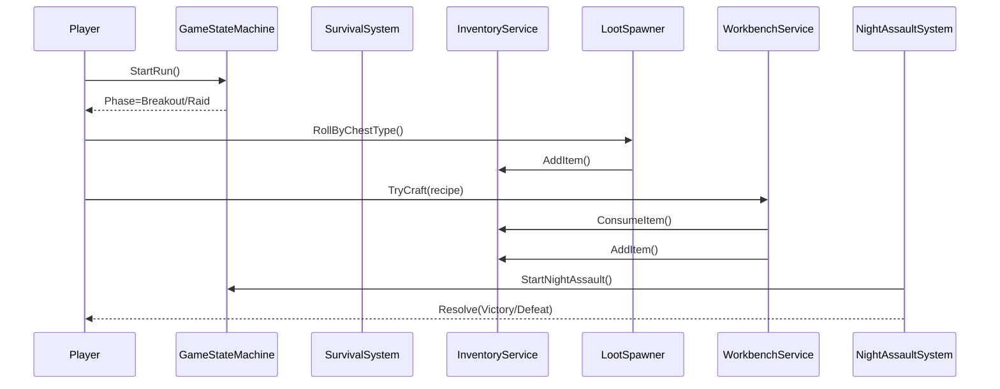
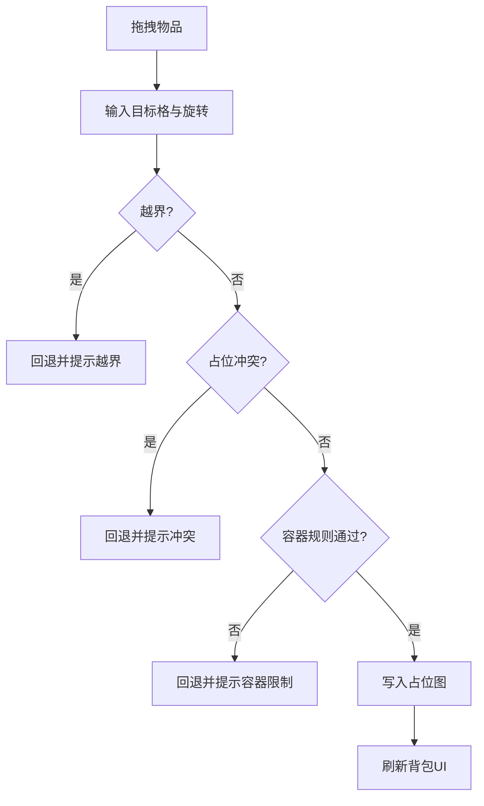

# 末日摸金生存游戏：核心玩法系统与开发执行文档（V1.0）

## 文档信息

| 字段 | 内容 |
|---|---|
| 文档状态 | Draft（可执行） |
| 当前版本 | v1.1.0 |
| 最后更新 | 2026-03-25 |
| 适用范围 | 玩法、程序、策划、测试、技术美术 |
| 关联代码目录 | `Assets/Scripts` |
| 规范要求 | 注释完整；编辑器展示统一使用 Odin Inspector |

## 版本记录

| 版本 | 日期 | 变更摘要 |
|---|---|---|
| v1.1.0 | 2026-03-25 | 新增“网格背包系统（类三角洲）”专项章节，补齐交互规则、数据结构、摆放算法、参数配置、排期与验收 |
| v1.0.0 | 2026-03-25 | 基于当前代码与玩法目标，建立系统说明、数据结构、算法流程、配置参数、开发排期与验收标准 |

---

## 目录

- [1. 目标与范围](#1-目标与范围)
- [2. 当前实现基线](#2-当前实现基线)
- [3. 核心玩法闭环](#3-核心玩法闭环)
- [4. 系统设计总览](#4-系统设计总览)
- [5. 系统详细设计](#5-系统详细设计)
  - [5.1 玩家素材管理系统](#51-玩家素材管理系统)
  - [5.2 生存状态系统](#52-生存状态系统)
  - [5.3 战斗机制系统](#53-战斗机制系统)
  - [5.4 摸金探索系统](#54-摸金探索系统)
  - [5.5 突围路线系统](#55-突围路线系统)
  - [5.6 庇护所与工作台系统](#56-庇护所与工作台系统)
  - [5.7 夜袭防守系统](#57-夜袭防守系统)
  - [5.8 状态机与事件总线](#58-状态机与事件总线)
  - [5.9 存档系统](#59-存档系统)
  - [5.10 UI与调试系统](#510-ui与调试系统)
  - [5.11 网格背包系统（类三角洲）](#511-网格背包系统类三角洲)
- [6. 关键数据结构设计](#6-关键数据结构设计)
- [7. 关键算法流程](#7-关键算法流程)
- [8. 配置参数规范](#8-配置参数规范)
- [9. 可视化示意图](#9-可视化示意图)
- [10. 开发安排与优先级](#10-开发安排与优先级)
- [11. 测试与验收标准](#11-测试与验收标准)
- [12. 团队协作与文档规范](#12-团队协作与文档规范)

---

## 1. 目标与范围

本项目定位为“**生存压力驱动的摸金循环**”：玩家在庇护所准备，突围进入摸金点获取资源，夜间防守并结算，再进入下一轮循环。  
本文档用于统一玩法、开发与测试实现口径，确保“设计可开发、开发可验证、验证可回归”。

---

## 2. 当前实现基线

> 交叉引用：详见 [5.8 状态机与事件总线](#58-状态机与事件总线)、[5.2 生存状态系统](#52-生存状态系统)。

当前已具备可运行的样机级能力：

- 主循环阶段切换（Shelter / Breakout / Raid / NightAssault / Result）
- 生存数值衰减与惩罚（饥饿、口渴、疲劳、感染、HP）
- 背包堆叠、消耗、计数
- 掉落按箱体类型 + 权重抽取
- 工作台配方校验与制造
- 庇护所饮水/休息/供电状态事件
- 夜袭开始、波次推进、胜利奖励结算
- Runtime 调试面板与调试动作入口
- Inspector 提示迁移至 Odin `PropertyTooltip`

---

## 3. 核心玩法闭环

1. **庇护所准备**：检查生存状态、整理背包、选择配方与补给。  
2. **突围阶段**：消耗弹药与体力，收集基础生存资源。  
3. **摸金阶段**：高风险高收益，获取稀有资源、蓝图与关键材料。  
4. **回撤结算**：按收益更新背包与模块进度。  
5. **夜袭防守**：根据防御、能源、武器状态决定胜负。  
6. **结果与下一轮**：结算奖励/损耗，进入新循环。

---

## 4. 系统设计总览

| 系统 | 定位 | 当前状态 | 下一阶段目标 |
|---|---|---|---|
| 玩家素材管理 | 资源流核心 | 已有背包基础 | 数据化配置 + 稀缺资源体系 |
| 生存状态 | 压力与惩罚源 | 已可运行 | UI可视化 + 平衡参数外置 |
| 战斗机制 | 风险来源 | 框架待完善 | 伤害模型、耐久、武器分层 |
| 摸金探索 | 收益来源 | 掉落基础已具备 | 场景交互、机关、污染事件 |
| 突围路线 | 资源补给与战斗场 | 待完善 | 节点化路线、随机事件 |
| 网格背包 | 资源管理交互核心 | 未实现 | 二维占位、旋转放置、容器嵌套、快速整理 |
| 庇护所与工作台 | 成长与转化 | 基础可用 | 多模块联动、蓝图解锁 |
| 夜袭防守 | 回合压力峰值 | 基础流程可用 | 敌群/目标/胜负条件实装 |
| 存档系统 | 持久化 | 未实现 | 可中断续玩与版本兼容 |
| UI系统 | 玩家操作入口 | 调试面板为主 | 正式HUD与交互界面 |

---

## 5. 系统详细设计

## 5.1 玩家素材管理系统

### 功能说明
- 管理物品堆叠、容量、增减、来源与去向。
- 支撑生存消耗、工作台制造、夜袭补给、任务奖励。
- 当前为“列表堆叠背包”基线，后续升级到 [5.11 网格背包系统（类三角洲）](#511-网格背包系统类三角洲)。

### 交互逻辑
- 外部系统（摸金、突围、夜袭、工作台）只通过 `AddItem/ConsumeItem/CountItem` 交互。
- 当新增物品时优先补同类堆叠，再创建新堆叠，直至容量上限。

### 数据结构设计
- `ItemStack { string itemId; int quantity; }`
- `InventoryService`：`maxSlots`、`defaultStackLimit`、`List<ItemStack> stacks`

### 关键实现要点
- 同类堆叠补齐 + 新堆叠创建的双阶段填充策略。
- 逆序消耗减少移除成本。
- 对无效 `itemId` 与 `amount<=0` 做防御式校验。

### 配置参数说明

| 参数 | 含义 | 默认值 | 调整建议 |
|---|---|---:|---|
| `maxSlots` | 背包格子上限 | 20 | 前期 16-24，后期可升级 |
| `defaultStackLimit` | 单堆叠上限 | 99 | 稀有资源建议更低上限 |

### 预期交付物
- 物品主数据表（ID、类型、堆叠上限、价值、用途）
- 背包 UI 与拖拽拆分逻辑

### 验收标准
- 背包满时新增受阻，日志或UI提示明确。
- 同 ID 物品自动合并，数量正确。
- 消耗后堆叠为 0 自动移除。

---

## 5.2 生存状态系统

### 功能说明
- 维护 `hunger/thirst/fatigue/hp/infected` 及派生属性。
- 提供吃喝睡、感染治疗、持续惩罚与状态事件。

### 交互逻辑
- `Update` 每帧 Tick 衰减与惩罚。
- 庇护所与消耗品通过 `Eat/Drink/Sleep/CureInfection` 调整状态。
- 派生属性影响战斗与移动系统（跨系统依赖）。

### 数据结构设计
- 运行时状态：`hunger、thirst、fatigue、hp、infected`
- 计时器：`hungerTimer、thirstTimer、fatigueTimer、hpPenaltyTimer`
- 派生参数：`MoveSpeedMultiplier、DamageMultiplier、StaminaMultiplier、CanUseChargeAttack`

### 关键实现要点
- 分离“衰减周期”和“每分钟惩罚”两个时钟。
- 所有核心数值统一 `0-100` 裁剪。
- 惩罚阈值配置化，便于平衡测试。

### 配置参数说明

| 参数 | 默认值 | 说明 |
|---|---:|---|
| `hungerIntervalSeconds` | 480 | 饥饿衰减周期 |
| `thirstIntervalSeconds` | 480 | 口渴衰减周期 |
| `fatigueIntervalSeconds` | 1440 | 疲劳衰减周期 |
| `warningThreshold` | 30 | 警告阈值 |
| `criticalThreshold` | 10 | 危险阈值 |
| `hpLossPerMinuteWhenHungry` | 3 | 饥饿掉血速率 |
| `hpLossPerMinuteWhenThirsty` | 5 | 缺水掉血速率 |
| `hpLossPerMinuteWhenInfected` | 2 | 感染掉血速率 |

### 预期交付物
- 生存 HUD（进度条 + 状态图标 + 告警）
- 生存参数 ScriptableObject

### 验收标准
- 10 分钟挂机后，衰减与惩罚曲线符合配置。
- 吃喝睡即时生效且不会越界。
- 感染状态可通过医疗行为解除。

---

## 5.3 战斗机制系统

### 功能说明
- 提供近战/远程伤害结算、命中判定、耐久消耗、受击反馈。
- 让生存状态（饥饿/疲劳）切实影响输出与操作能力。

### 交互逻辑
- 输入系统触发攻击 -> 武器组件生成攻击请求 -> 伤害系统结算 -> 目标反馈。
- 每次攻击按武器类型扣耐久，耐久低于阈值触发性能衰减。
- 与 [5.6 庇护所与工作台系统](#56-庇护所与工作台系统) 联动修复与升级。

### 数据结构设计（建议）
- `WeaponDefinition`：基础伤害、攻速、耐久上限、穿透、暴击、修复材料
- `DamageContext`：攻击方、目标、命中部位、距离、伤害类型、倍率
- `WeaponRuntimeState`：currentDurability、isBroken

### 关键算法流程
- 伤害 = 基础伤害 × 生存倍率 × 命中部位倍率 × 护甲穿透修正 × 随机浮动。
- 耐久扣减 = 基础消耗 × 武器类别系数 × 环境系数（如重击/防御碰撞）。

### 配置参数说明
- 近战基础伤害区间、射击扩散、爆头倍率、耐久消耗速率、破损阈值。

### 预期交付物
- 武器主数据 + 战斗结算模块 + 命中反馈（音效/飘字/受击动画）

### 验收标准
- 近战/远程完整可打通，且耐久消耗与修复可闭环。
- 生存状态导致输出/机动变化有明确体感。

---

## 5.4 摸金探索系统

### 功能说明
- 在高风险区域进行搜刮、解谜、开箱、躲陷阱，获取高价值资源。

### 交互逻辑
- 玩家进入摸金点 -> 触发场景事件 -> 开箱/机关判定 -> 产出掉落 -> 可能附带感染/噪声惩罚。
- 与掉落系统联动：`LootChestType` 驱动掉落池。

### 数据结构设计（建议）
- `RaidPointDefinition`：难度、噪声值、污染值、箱体分布
- `LootChestSpawn`：类型、位置、权重组、刷新条件
- `TrapDefinition`：触发条件、效果（伤害/感染/报警）

### 关键实现要点
- 分层掉落池（生存、武器、资源、稀有、医疗）。
- 风险收益挂钩：高风险点提高稀有蓝图概率。
- 污染陷阱与感染系统联动。

### 预期交付物
- 1 个标准摸金点 + 1 个高风险摸金点
- 开箱交互组件、陷阱组件、掉落配置资产

### 验收标准
- 每次探索都可形成“收益+风险”反馈，非纯随机堆物。
- 稀有掉落概率符合配置曲线。

---

## 5.5 突围路线系统

### 功能说明
- 承担“战斗消耗 + 资源补给 + 节奏过渡”作用。

### 交互逻辑
- 节点式推进：补给点/战斗点/事件点/捷径点。
- 路线事件影响当轮状态（弹药、感染、疲劳、时间消耗）。

### 数据结构设计（建议）
- `RouteNode`：节点类型、敌人组、资源点、触发器
- `RouteEvent`：概率、条件、收益/惩罚

### 关键实现要点
- 节点化配置 + 随机扰动，保证可复玩。
- 与生存资源采集（野菜/污水/木材/矿石）联动。

### 预期交付物
- 1 条完整突围样例路线（含 6-8 节点）

### 验收标准
- 可稳定从起点推进至终点，且事件结果可复现可测试。

---

## 5.6 庇护所与工作台系统

### 功能说明
- 庇护所负责恢复、储备与防守准备；工作台负责加工、制造、修复与升级。

### 交互逻辑
- 庇护所模块提供恢复与供电状态。
- 工作台校验配方与材料，成功后产出并回写背包。
- 蓝图与等级共同约束高级配方解锁。

### 数据结构设计
- `WorkbenchRecipe`：`recipeId`、`requiredWorkbenchLevel`、`outputItemId`、`outputQuantity`、`requirements`
- `WorkbenchMaterialRequirement`：`itemId`、`quantity`

### 关键实现要点
- 配方有效性校验（空 ID、非法数量）前置。
- 消耗与产出分步执行，保障事务完整性。
- 支持后续扩展为“队列制造”。

### 配置参数说明
- 工作台等级成长曲线、配方耗材、制造耗时、电力消耗。

### 预期交付物
- 工作台正式 UI、配方分类、蓝图解锁流程

### 验收标准
- 配方解锁条件正确，材料不足阻止制造并提示原因。
- 修复消耗规则与武器耐久系统一致。

---

## 5.7 夜袭防守系统

### 功能说明
- 夜间回合压力峰值，验证白天准备质量（资源、防御、武器、状态）。

### 交互逻辑
- `StartAssault` 进入夜袭并发预警事件。
- 波次推进后按胜负结算奖励/损耗。
- 结果回写主循环状态机进入结算阶段。

### 数据结构设计
- `NightAssaultResult`：`Victory/Defeat`
- `NightAssaultStartedEvent`、`NightAssaultResolvedEvent`

### 关键实现要点
- 防御工事与能源状态联动（断电降效）。
- 奖励与风险挂钩（胜利奖励、失败惩罚）。

### 预期交付物
- 夜袭 AI 波次配置、目标点系统、结算界面

### 验收标准
- 胜利与失败路径都可稳定触发，奖励/惩罚逻辑正确。

---

## 5.8 状态机与事件总线

### 功能说明
- 状态机控制主循环阶段，事件总线负责系统解耦通信。

### 交互逻辑
- 状态切换时发布 `GamePhaseChangedEvent`。
- 生存系统每帧发布 `SurvivalTickEvent`。
- 夜袭/掉落/供电事件用于 UI、任务、日志监听。

### 数据结构设计
- `GamePhase` 枚举
- `EventBus`：`Subscribe/Unsubscribe/Publish`

### 关键实现要点
- 事件对象不可变结构体，减少误修改。
- 订阅管理需在生命周期中成对注册/注销。

### 预期交付物
- 统一事件命名规范与事件追踪面板（开发态）

### 验收标准
- 阶段切换与关键业务事件均可被 UI/日志系统监听并正确响应。

---

## 5.9 存档系统

### 功能说明
- 支持中断续玩、跨会话恢复、版本升级兼容。

### 交互逻辑
- 手动保存、阶段结算自动保存、异常退出恢复。
- 读取时按版本号执行迁移策略。

### 数据结构设计（建议）
- `SaveData`：版本号、阶段、生存状态、背包、工作台等级、夜袭进度、时间戳。

### 关键实现要点
- 原子写入（临时文件 + 替换）避免坏档。
- 字段扩展保持向后兼容。

### 预期交付物
- `SaveService`、存档槽 UI、兼容策略说明

### 验收标准
- 存读一致、跨版本可降级读取、坏档不崩溃。

---

## 5.10 UI与调试系统

### 功能说明
- 正式 UI 承担玩家交互；调试 UI 服务联调与测试。

### 交互逻辑
- 正式 UI 监听事件总线更新显示。
- 调试面板保留开发期开关，发行版可禁用。

### 数据结构设计
- UI ViewModel（建议）：状态快照、通知字段、格式化文本。

### 关键实现要点
- 业务状态与 UI 展示解耦，避免双向污染。
- Inspector 统一 Odin 展示与注释规范。

### 预期交付物
- HUD、背包、工作台、夜袭结算、设置界面

### 验收标准
- 不依赖调试按钮即可完成完整游戏循环。

---

## 5.11 网格背包系统（类三角洲）

### 功能说明
- 采用二维网格占位管理背包内容，物品拥有宽高尺寸、旋转状态与占位形状。
- 支持“主背包 + 口袋 + 挂载容器（包中包）”结构，强化资源管理决策深度。
- 支持拖拽放置、自动吸附、冲突提示、快速整理与快速转移。

### 交互逻辑
- 玩家拖拽物品时，系统实时显示可放置区域（绿色）与冲突区域（红色）。
- 释放时执行合法性判定：边界、占用冲突、容器类型约束、重量/容量约束。
- 旋转操作（默认 `R`）会交换 `width/height` 并重新判定。
- 双击或快捷键触发“快速转移”时，按容器优先级执行自动摆放。

### 数据结构设计（建议）
- `GridContainerDefinition`
  - `containerId`
  - `rows`
  - `columns`
  - `allowNestedContainer`
  - `allowedItemTags`
- `GridItemDefinition`
  - `itemId`
  - `width`
  - `height`
  - `canRotate`
  - `maxStack`
  - `itemTags`
  - `weight`
- `GridItemInstance`
  - `instanceId`
  - `itemId`
  - `stackCount`
  - `rotation`（0/90）
  - `containerId`
  - `originRow`
  - `originColumn`
- `GridOccupancyMap`
  - `bool[,] occupied`
  - `string[,] occupantInstanceId`

### 关键算法流程
- **放置校验（CanPlace）**
  1. 根据旋转态计算实际占位宽高。
  2. 校验原点与矩形占位是否越界。
  3. 遍历占位矩形，判断是否与已有实例冲突。
  4. 校验容器标签与嵌套规则。
  5. 全部通过返回可放置。
- **自动摆放（AutoPlace）**
  1. 按容器优先级与物品价值排序。
  2. 对每个物品执行“左上到右下”首个可放位置搜索。
  3. 若不可放，尝试旋转后再次搜索。
  4. 仍失败则加入“未放入列表”并反馈 UI。
- **快速整理（AutoSort）**
  1. 提取容器内全部实例并清空占位图。
  2. 先放大体积高价值物品，再放小体积补缝物品。
  3. 重建占位图并刷新 UI。

### 配置参数说明

| 参数 | 含义 | 默认建议 |
|---|---|---:|
| `mainBagRows` | 主背包行数 | 8 |
| `mainBagColumns` | 主背包列数 | 10 |
| `pocketRows` | 口袋行数 | 2 |
| `pocketColumns` | 口袋列数 | 3 |
| `quickTransferPolicy` | 快速转移策略（FirstFit/BestFit） | FirstFit |
| `autoSortEnabled` | 是否允许一键整理 | true |
| `nestedContainerDepth` | 容器嵌套层级上限 | 1 |
| `maxCarryWeight` | 最大可携带重量 | 35 |

### 可视化示意图

```text
主背包（8x10）示意：
+-------------------------------------------------+
| [2x3步枪] [2x2医疗包] [1x3弹匣] [2x1食物]      |
| [2x3步枪] [2x2医疗包] [1x3弹匣] [2x1食物]      |
| [2x3步枪] [1x1水]    [1x1钥匙] [3x2工具箱]     |
| ...                                             |
+-------------------------------------------------+
```

### 预期交付物
- 网格背包运行时模型（容器、实例、占位图）
- 背包 UI（拖拽、旋转、高亮、快速转移、一键整理）
- 物品尺寸配置表与容器配置资产（ScriptableObject）
- 与现有 `InventoryService` 的兼容适配层（旧接口不破坏）

### 验收标准
- 任意放置操作 100% 满足边界/冲突约束，不出现“穿模占位”。
- 旋转后占位正确刷新，撤销/还原位置一致。
- 快速转移与整理结果可复现，不丢失物品实例。
- 多容器切换（主包/口袋/挂载包）性能稳定，无明显卡顿。

---

## 6. 关键数据结构设计

| 结构 | 来源 | 说明 |
|---|---|---|
| `ItemStack` | 已实现 | 背包堆叠基础单元 |
| `LootEntry` | 已实现 | 掉落条目，包含类型、数量区间、权重 |
| `WorkbenchRecipe` | 已实现 | 配方定义，含等级与材料要求 |
| `GamePhaseChangedEvent` | 已实现 | 阶段切换广播 |
| `NightAssaultResolvedEvent` | 已实现 | 夜袭结果广播 |
| `SaveData` | 待开发 | 存档主结构，需版本化 |
| `WeaponDefinition` | 待开发 | 武器配置结构 |
| `GridContainerDefinition` | 待开发 | 网格容器定义（行列、规则） |
| `GridItemInstance` | 待开发 | 网格物品运行时实例（位置、旋转、数量） |
| `GridOccupancyMap` | 待开发 | 占位图，用于冲突判定与渲染 |

---

## 7. 关键算法流程

### 7.1 掉落权重抽取
1. 根据箱体类型过滤掉落池。  
2. 汇总总权重 `totalWeight`。  
3. 随机 `roll in [1,totalWeight]`。  
4. 累加游标命中后返回条目。  
5. 按 `min/max` 随机数量生成 `ItemStack`。

### 7.2 生存衰减与惩罚
1. 每帧累加各计时器。  
2. 达到周期则扣减对应数值并回拨计时器。  
3. 每 60 秒执行危险状态掉血。  
4. 重算移动/伤害/体力等派生倍率。

### 7.3 工作台制造事务
1. 校验配方存在与等级满足。  
2. 校验材料足够。  
3. 扣减材料。  
4. 发放产出；失败时记录告警并回滚策略（待实现）。

### 7.4 网格背包放置与整理
1. 接收拖拽目标位置与旋转态。  
2. 执行 `CanPlace` 判定（越界/冲突/容器规则）。  
3. 可放置则更新 `GridOccupancyMap` 与 `GridItemInstance`。  
4. 不可放置则回退原位并提示冲突原因。  
5. 触发整理时执行 `AutoSort`，并返回未能放入的实例列表。

---

## 8. 配置参数规范

| 配置域 | 推荐格式 | 热更需求 | 责任角色 |
|---|---|---|---|
| 生存参数 | ScriptableObject | 高 | 策划/程序 |
| 掉落表 | ScriptableObject + CSV 导入 | 高 | 策划 |
| 配方表 | ScriptableObject | 中 | 策划 |
| 夜袭波次 | ScriptableObject | 高 | 策划/关卡 |
| 武器主数据 | ScriptableObject | 高 | 战斗策划 |
| 网格背包配置 | ScriptableObject | 高 | 系统策划/程序 |

参数命名规范：
- 统一英文 `camelCase` 字段；单位写入后缀（如 `IntervalSeconds`）。
- 所有可调参数必须有中文 Odin 提示 `PropertyTooltip`。

---

## 9. 可视化示意图

### 9.1 玩法主循环


### 9.2 核心系统交互时序



### 9.3 网格背包放置判定流程



---

## 10. 开发安排与优先级

### 阶段目标

| 阶段 | 周期 | 核心目标 | 关键交付 |
|---|---|---|---|
| Phase A（P0） | 1-3 周 | 主循环可玩 + 配置数据化 + 存档 + 网格背包底层 | 编排器、SO 配置、SaveService、Grid Runtime |
| Phase B（P1） | 4-7 周 | 战斗与摸金深化 + 正式 UI + 网格背包交互 | 战斗结算、摸金场景、HUD/网格背包/工作台 |
| Phase C（P1） | 8-10 周 | 夜袭完整化 + 庇护所多模块联动 | 波次AI、防御工事、能源系统 |
| Phase D（P2） | 11-12 周 | 测试稳定性 + 平衡与体验优化 | 自动化测试、参数调优、性能优化 |

### 优先级建议

1. **P0：主循环编排器 + 数据化配置 + 存档 + 网格背包运行时**（先保证“可玩且可持续迭代”）  
2. **P1：战斗与摸金、正式 UI、网格背包交互、夜袭完整化**（提升可玩性与体验）  
3. **P2：任务引导、自动化测试、性能与内容扩展**（提升稳定性与留存）

---

## 11. 测试与验收标准

### 功能验收

| 测试项 | 验收标准 |
|---|---|
| 主循环 | 可连续完成 3 轮无阻塞 |
| 生存系统 | 衰减、惩罚、恢复符合参数 |
| 掉落系统 | 权重分布统计误差在可接受区间 |
| 工作台 | 材料校验、消耗、产出一致 |
| 夜袭 | 胜败路径与奖励惩罚正确 |
| 存档 | 保存读取一致，坏档不崩溃 |
| 网格背包 | 放置冲突、旋转、整理、转移规则正确且无丢物 |

### 非功能验收
- 关键场景帧率稳定，内存无明显泄漏。
- 错误日志可定位，关键事件有统一追踪字段。
- 文档与配置保持一致，提交需同步更新版本记录。

---

## 12. 团队协作与文档规范

- 本文档按版本号维护，新增系统需补充“功能/交互/数据/算法/参数/验收”六要素。
- 代码实现必须包含中文注释（类、字段、关键方法）。
- Inspector 展示统一使用 Odin（`PropertyTooltip`、`LabelText`、`BoxGroup`、`FoldoutGroup` 等）。
- 配置参数优先数据化，不将平衡参数硬编码在业务逻辑中。
- 测试用例与需求条目建立双向追踪（需求 ID ↔ 用例 ID）。

---

## 附录：当前代码映射（便于查阅）

- 主循环状态机：`Assets/Scripts/Core/GameStateMachine.cs`
- 事件总线与事件：`Assets/Scripts/Core/EventBus.cs`、`Assets/Scripts/Core/GameplayRuntimeEvents.cs`
- 生存系统：`Assets/Scripts/Survival/SurvivalSystem.cs`
- 背包系统：`Assets/Scripts/Inventory/InventoryService.cs`
- 掉落系统：`Assets/Scripts/Gameplay/Loot/LootSpawner.cs`
- 工作台系统：`Assets/Scripts/Gameplay/Workbench/WorkbenchService.cs`
- 庇护所系统：`Assets/Scripts/Gameplay/Shelter/ShelterModuleService.cs`
- 夜袭系统：`Assets/Scripts/Gameplay/Night/NightAssaultSystem.cs`
- 启动与调试：`Assets/Scripts/Gameplay/GameBootstrap.cs`、`Assets/Scripts/Gameplay/RuntimeDebugPanel.cs`
